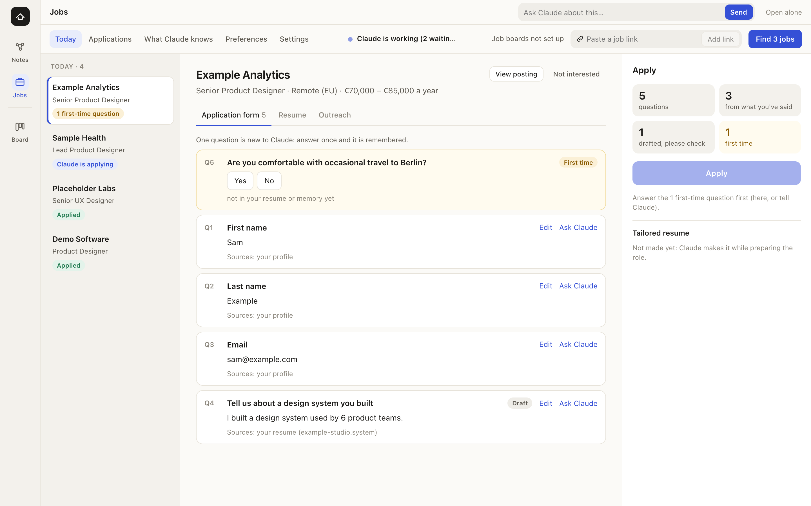
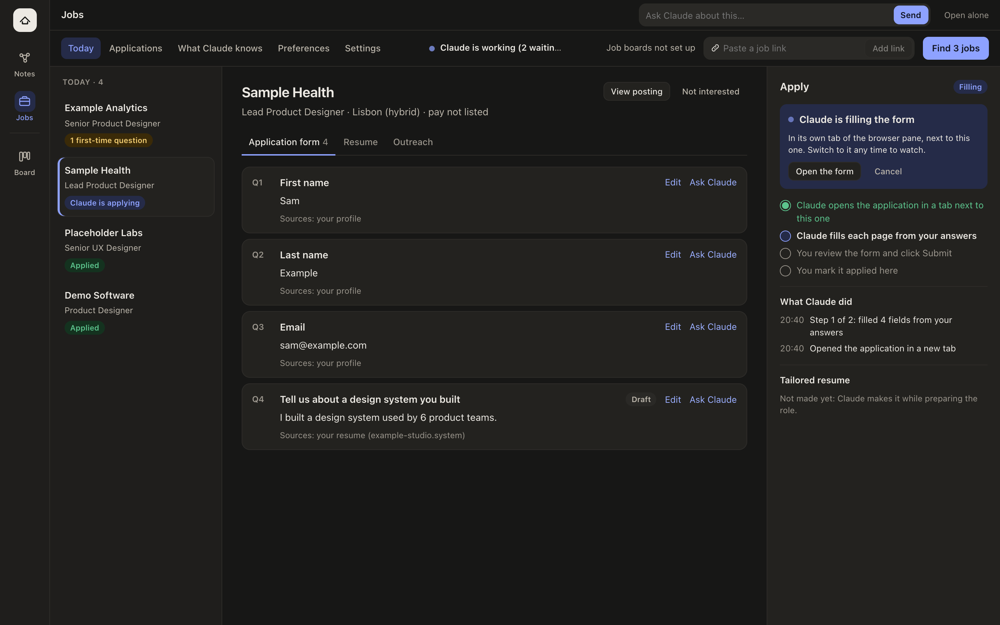
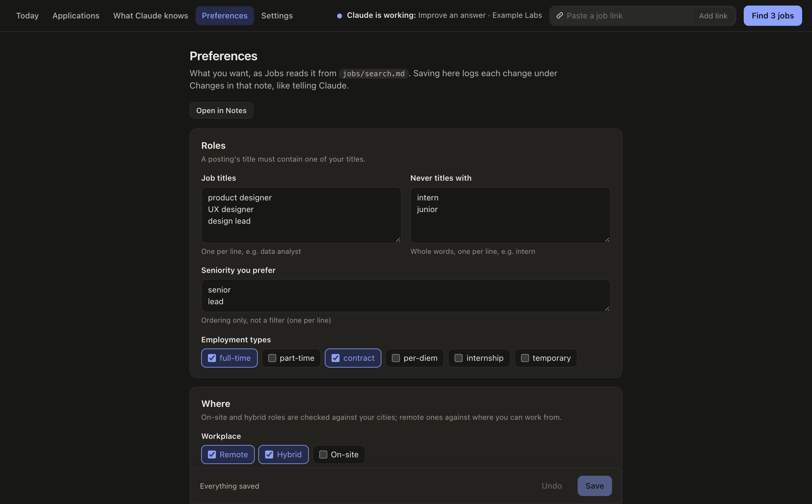
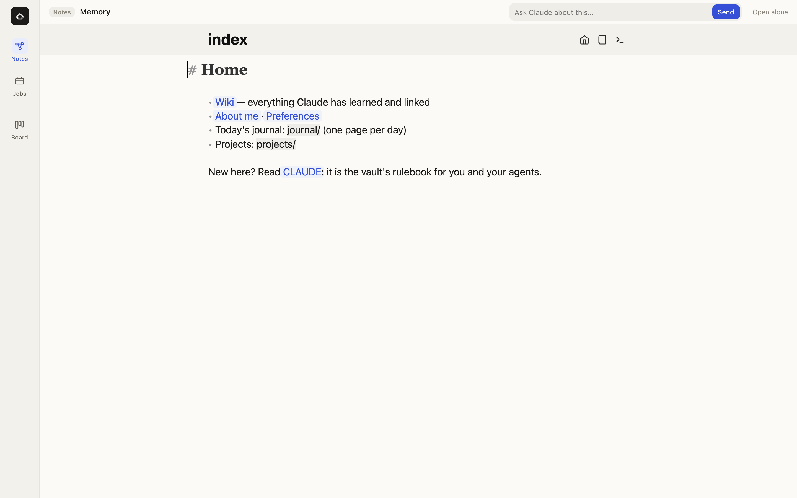
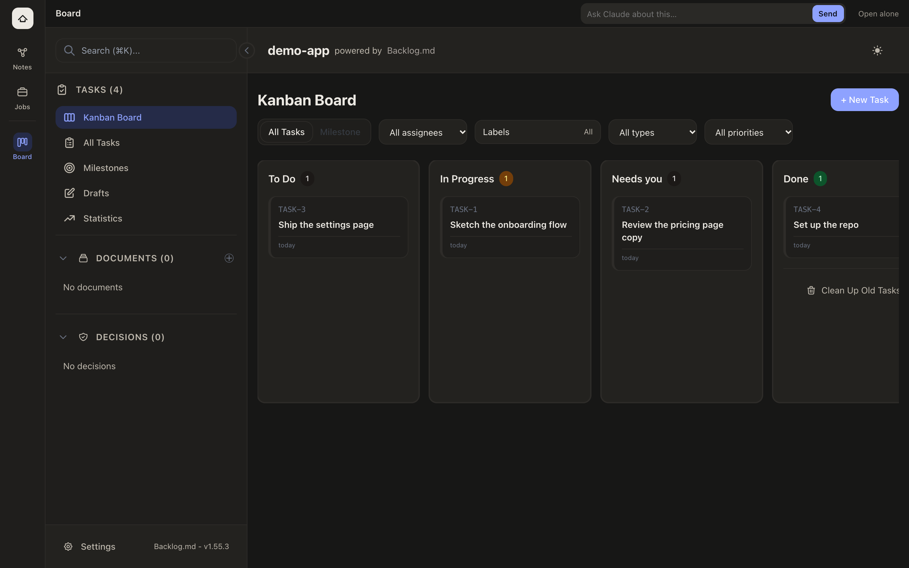
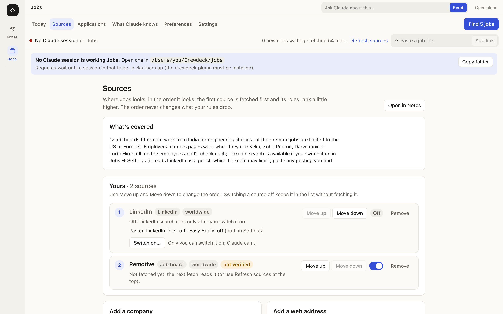
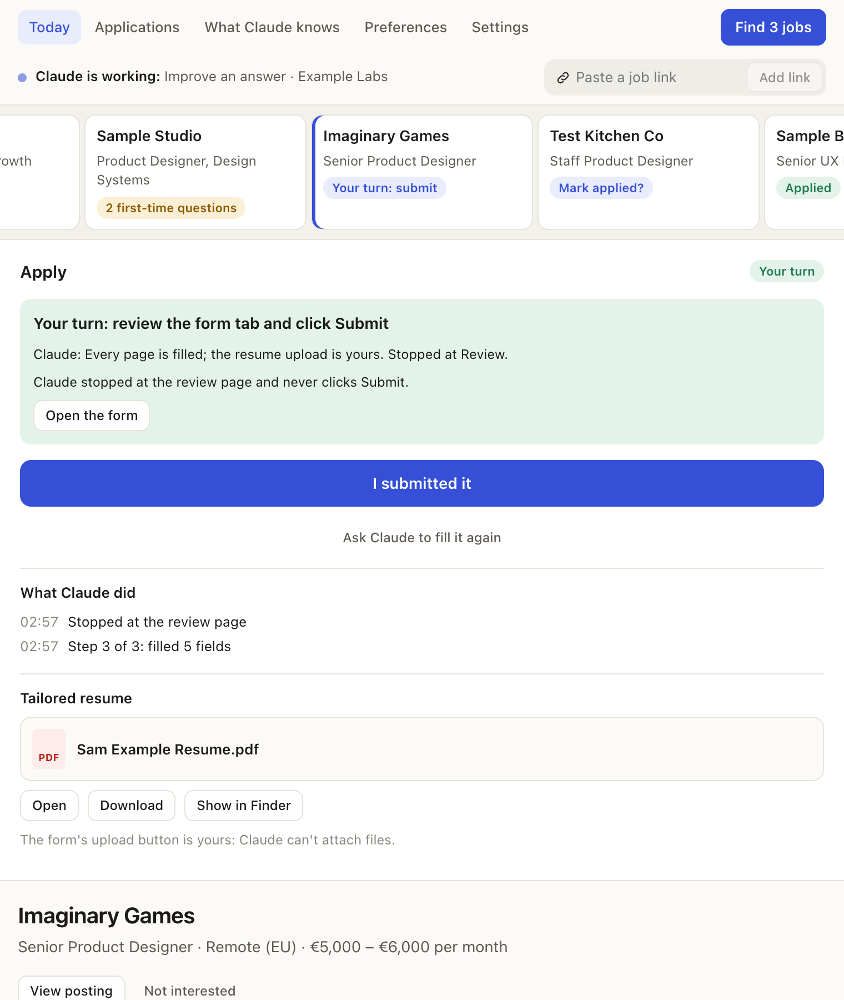
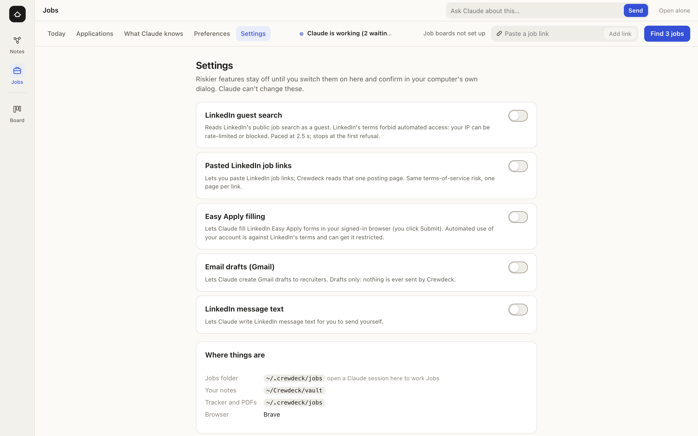

# Crewdeck

> 🚧 **Under construction.** Notes, boards, Jobs and the bridge work; "start an agent on a ticket" is still being built.
> Expect rough edges and breaking changes ([CHANGELOG](CHANGELOG.md)).

**Your one-person company, inside Claude desktop.** Notes, memory, tickets, a job search and your Claude agents in one
workspace that opens next to the chat. You click and decide; agents read and write the same files.



Crewdeck builds as little as it can. It wires together mature open-source tools:

| | Tool | Why |
|---|---|---|
| Notes · memory · backlinks | [SilverBullet](https://silverbullet.md) (MIT) | Markdown notes in the browser; plain files on disk (they open in Obsidian too) |
| Tickets · kanban | [Backlog.md](https://github.com/MrLesk/Backlog.md) (MIT) | Tickets are Markdown files in each project's repo; agents use its CLI |
| Agents | [Claude Code](https://claude.com/claude-code) in the Claude desktop app | Sessions do the work; Crewdeck shows in Claude's browser pane |

Everything runs on your machine, bound to `127.0.0.1`. No accounts, no cloud, no telemetry.

**Where it lives:** **http://crewdeck.localhost:4848** in any browser or in Claude desktop's browser pane, and
**`/crewdeck`** in any Claude session, which opens today's to-dos, jobs and tickets beside the chat. With the background
service it is always running ([Always on](#always-on-and-from-anywhere)).

## Who it's for

**Anyone looking for work**, in any field and any country: a nurse on nights, an accountant in Berlin, a store manager
in Pune, a new graduate, a warehouse worker without a resume, a freelance translator, an engineer who wants remote work.
Claude talks with you in your own language; the page itself is in English for now.

What you need: a Mac or Linux computer with the [Claude desktop app](https://claude.ai/download) on a plan that
includes its **Code** tab, and Chrome, Brave or Edge (Claude fills job forms in it). Nothing to install by hand and no
programming. Windows: not yet.

## Get started: two steps

1. **Add Crewdeck to Claude.** In the Claude desktop app, open the **Code** tab, click **+** next to the message box →
   **Plugins** → **Add marketplace**, enter `pulkitnagpal/crewdeck`, then **Add plugin** → **crewdeck**. If your Mac
   asks to install the "command line developer tools", click **Install**: Claude needs them to fetch plugins, once.
   (In Claude Code in a terminal: `claude plugin marketplace add pulkitnagpal/crewdeck`, then
   `claude plugin install crewdeck@crewdeck`.)
2. **Type `/crewdeck`** in a new Code session and click **Set up Crewdeck**. It downloads what Crewdeck needs (about
   70 MB, each download checked before it is used), creates your notes in `~/Crewdeck/vault`, and keeps Crewdeck running
   in the background from now on. It takes a few minutes; the panel shows each step.

That's it. The panel beside the chat then shows your day (to-dos, jobs, tickets) and **Set up my job search**, which
opens Claude's job-search chat: confirm the folder, press Enter, and Claude interviews you (about 20 minutes, with or
without a resume). Crewdeck itself is at **http://crewdeck.localhost:4848** in any browser, and `/crewdeck` brings it
back in any Claude session. The full walk-through is [docs/jobs/first-run.md](docs/jobs/first-run.md).

## What's in it

- **Notes.** Your vault: what Claude knows about you (`me/`), a wiki Claude keeps, a journal, notes per project. The
  vault's `CLAUDE.md` tells every agent the rules. Your files are listed on the left; the buttons at the top open
  **Today** (today's journal page with a To do list), make a **new page**, and add bold, a checkbox, a heading or a link
  to another page. Type `/` in a page for more. They are SilverBullet's own features, switched on by Crewdeck.
- **Boards.** One kanban per project (To Do · In Progress · Needs you · Done). Tickets live in the project's repo. To add
  one, open a Claude Code session in the project's folder, type `/crewdeck` and click **Add this folder as a board**.
- **Jobs.** A job search for any role in any country. Claude interviews you once and writes your notes; it finds roles
  within a token budget, reads a posting you paste, prepares every answer from your own words, and fills the form in a
  tab next to Crewdeck. **You click Submit. Crewdeck never submits.**
- **The `crewdeck` plugin** for Claude Code. Its bridge brings your clicks on the page into the Claude session that owns
  that work, and its skills carry the Jobs playbooks and "remember this" for every session.

| | |
|---|---|
|  |  |
|  |  |

## Requirements

For the two steps above: macOS or Linux, the Claude desktop app with its Code tab, a Chromium-based browser (Chrome,
Chromium, Brave or Edge) for Jobs, and an internet connection for the first setup. `/crewdeck` brings its own Node
(25.9.0 from nodejs.org, checksum-checked) into `~/.crewdeck/runtime`, so nothing else is needed. Linux also needs
`bubblewrap` and `socat` for Claude Code's sandbox in the jobs workspace.

From source (developers, below): Node.js 22.18 or newer (25 or newer to fetch from job boards: from 25, Node can run
the job-board providers with no network of their own), git and `unzip`.

## From source (developers)

A step-by-step walk-through for a new user, with what you should see at each step, is in
[docs/jobs/first-run.md](docs/jobs/first-run.md). The short version:

```bash
git clone https://github.com/pulkitnagpal/crewdeck.git
cd crewdeck
npm ci
node src/cli.ts setup --service # everything: ~/.crewdeck, your vault, Jobs, your jobs folder, the plugin in Claude,
                                # and Crewdeck running in the background from now on: http://crewdeck.localhost:4848
```

Without `--service`, start it yourself with `node src/cli.ts up` and leave that running.

`npm link` in the checkout puts `crewdeck` on your PATH; this README writes `crewdeck …` for `node src/cli.ts …`.
`crewdeck up` also writes `~/.crewdeck/bin/crewdeck`, a small script that runs this checkout (the skills use it).

Then:

1. Open **http://crewdeck.localhost:4848** in Claude desktop's browser pane (or any browser) and click **Jobs**.
2. Click **Open in Claude** on the Jobs page (or run `crewdeck open session`): Claude desktop opens a new Code session
   in your jobs folder, **`~/Crewdeck/jobs`**. Confirm the folder and press Enter on the hello it fills in. Its status
   line shows `Crewdeck · jobs`, and the Jobs page shows **Claude connected**.
3. On the Jobs page click **Set up with Claude** and answer Claude's questions in that chat.

`setup` options: `--service` / `--no-service` (run in the background, see [Always on](#always-on-and-from-anywhere)),
`--preset <name>` (see Presets), `--vault <path>` puts the vault elsewhere, `--no-plugin` skips the plugin. It runs the same steps as `crewdeck init`, `crewdeck jobs init` and the plugin install below, each of which also
works on its own (`jobs init` also takes `--home <dir>` for the tracker, `--workspace <dir>` for the jobs folder and
`--no-providers` to skip the download). Running any of them again is safe.
Add a project board: in a Claude Code session in the project's folder, type `/crewdeck` and click **Add this folder
as a board** (or `crewdeck add-project <name> <path-to-git-repo>`).

## Install the plugin

The plugin is called `crewdeck` (version 0.6.0). The repo is its own plugin marketplace, also called `crewdeck`.
`crewdeck setup` installs it for you from your checkout; the commands below do the same by hand.

**From your checkout** (works before anything is published). Claude keeps a copy of the plugin per version, so after a
`git pull` run `crewdeck setup` again (or `claude plugin marketplace update crewdeck && claude plugin update
crewdeck@crewdeck`) and start a new session:

```bash
claude plugin marketplace add /path/to/crewdeck
claude plugin install crewdeck@crewdeck --config port=4848
```

**From GitHub:**

```bash
claude plugin marketplace add pulkitnagpal/crewdeck
claude plugin install crewdeck@crewdeck --config port=4848
```

Or in the desktop app: + next to the prompt box → Plugins → Add marketplace `pulkitnagpal/crewdeck` → add
**crewdeck**. `port` is the port Crewdeck runs on (4848 unless you changed it); change it later with
`/plugin configure crewdeck@crewdeck`. Both commands write your user Claude Code settings, which the desktop app's Code
sessions use; start a new session (or restart the app) afterwards.

**Had the old `crewdeck-bridge` plugin?** It was renamed to `crewdeck` in 0.3.0. Remove it, and remove the marketplace
before adding it again (both are called `crewdeck`, so a second one with that name can't be added):

```bash
claude plugin uninstall crewdeck-bridge@crewdeck
claude plugin marketplace remove crewdeck
```

`claude plugin list` shows what is installed; `claude plugin validate /path/to/crewdeck` checks the manifests.

## Always on and from anywhere

- **The address.** `http://crewdeck.localhost:4848` works in every browser on this computer with nothing to set up:
  names ending in `.localhost` always mean this computer. `http://localhost:4848` still works.
- **Always running.** `crewdeck service install` runs Crewdeck in the background and starts it when you log in (a
  LaunchAgent on macOS, a `systemd --user` unit on Linux; no admin password). `crewdeck service status` says whether it
  runs and shows its last log lines; `crewdeck service restart` after a `git pull`; `crewdeck service uninstall` removes
  it. Its log is `~/.crewdeck/logs/service.log`. Without it, `crewdeck up` runs Crewdeck until you stop it; `up` says so
  and does nothing when Crewdeck is already running.
- **`crewdeck open`** (or `open jobs`, `open notes`) starts Crewdeck if it isn't running and opens it in your browser.
  **`crewdeck open session`** opens a new Claude Code session in your jobs folder in Claude desktop (the same as **Open
  in Claude** on the Jobs page and **Start the Jobs session** in the `/crewdeck` panel): Claude desktop asks you to
  confirm the folder and fills in a hello you send with Enter.
- **In any Claude session**, type **`/crewdeck`**: a panel beside the chat shows today's to-dos (tick them, add one),
  what Jobs is waiting on, and your open tickets, with buttons to open Crewdeck, Jobs or today's notes. It starts
  Crewdeck first when it isn't running. `/crewdeck open`, `/crewdeck jobs` and `/crewdeck notes` open the page. Saying
  "open Crewdeck" works too. To-dos are the checkboxes of today's journal page (`journal/YYYY-MM-DD.md` in your vault),
  so Notes and Obsidian show the same list.
- **Without the port** (macOS, optional): `crewdeck address --short` sets up `http://crewdeck.localhost`, and
  `--name crew.deck` adds `http://crew.deck`. Your admin password is needed once, so Crewdeck only writes the files and
  prints the commands for you to run: a redirect from port 80 to Crewdeck's port on this computer only, loaded at
  startup. `crewdeck address --undo` prints how to remove it. The first time, type `crew.deck/` with the slash: a
  browser may search for a bare `crew.deck`.

## What's stored where

Two kinds of things, kept apart:

- **Your knowledge is notes in your vault** (`~/Crewdeck/vault`): who you are, your work, what you want, where to
  look, what Claude learned. They are plain Markdown files you can read, edit, copy or back up; nothing about you lives
  anywhere else. You can change any of it in Notes; Claude changes it only through `crewdeck jobs …` commands that
  validate what they write and keep your own words.
- **Crewdeck's machine state is in `~/.crewdeck/`** (private to you): the roles it found, the form questions and
  answers it prepared, resume PDFs, the job-board code, your risky switches. You never need to edit it; it can be
  rebuilt from the notes.
- **Your jobs folder** (`~/Crewdeck/jobs`) is only where you open the Claude session that works on Jobs. Crewdeck
  writes its rules there (`CLAUDE.md`, `.claude/settings.json`) and rewrites them on every start.

| Note | What |
|---|---|
| `me/profile.md` | Who you are: name, contact, links, education, standard answers ("notice period") |
| `me/career.md` | Your resume sections and the fact bank: every bullet Claude may use, word for word |
| `jobs/search.md` | What you want: titles, places, workplace, pay, languages, exclusions, daily picks. Its **Changes** log keeps each change with the date and your words |
| `jobs/memory.md` | What Claude learned from you: answers, facts, style rules, "not interested" reasons, each with your quote |
| `jobs/sources.md` | Where to look, in priority order: job boards, employers' careers pages, LinkedIn's place in the list |
| `journal/YYYY-MM-DD.md` | An "Applied to …" line for each application |

Machine state is in `~/.crewdeck/jobs/` (private, 0700): `jobs.db` (roles, answers, form questions), `out/<role>/`
(tailored resume PDFs, scratch files), `providers/` (the pinned job-board code). Your risky switches are in
`~/.crewdeck/config.yaml`. A complete fictional example is in [examples/jobs/](examples/jobs/).

**Where your job sources live.** Three places, each with one owner:
- **Your choice:** which sources, in which order, your employers' careers pages and any web address you added. It
  lives in the vault note `jobs/sources.md`, which you can read and edit in Notes.
- **Everything Crewdeck can fetch:** each board's kind, regions, fields and limits. It is a read-only catalog shipped in
  this repo (`src/jobs/data/sources-catalog.yaml`), updated only with the pinned providers.
- **What happened at the last fetch:** counts, errors and when. It is machine state in `~/.crewdeck/jobs/state/`.

The list is ordered: the first source is fetched first and its roles rank first (pasted links still come before
everything). Order never changes what your rules drop. LinkedIn can sit in your list like any other source, but switching
it on stays yours alone (Jobs → Settings, with your computer's confirmation dialog).

## Sources

Jobs → **Sources** shows your list in order, with each source's last fetch, and lets you reorder it (Move up / Move
down), switch a source off without removing it, remove it, add one from the catalog (filter by region, field and kind),
add a company by its careers page (Crewdeck checks which system runs it, in the provider sandbox) or add any other jobs
page. The line at the top says plainly what is covered for you and what isn't: if no job board covers your field where
you live (nursing in the US, retail in India, logistics in Texas…), it says so, and what still works: employers'
careers pages, LinkedIn if you switch it on, and links you paste. Crewdeck never invents a source.

During setup, Claude proposes sources from your notes (`crewdeck jobs sources suggest`), fetches once, and shows you
how many real postings your choices catch before anything is used (`crewdeck jobs preview`). When a Find returns fewer
jobs than you asked for, Today shows **Why so few?**: the funnel from fetched to picked, the rule that dropped most, and
one-click changes to try, each previewed first.



## Presets (deprecated)

Setup with Claude proposes sources from your own profile (`crewdeck jobs sources suggest`), so presets are going away.
For one more release, `crewdeck jobs init --preset <name>` still seeds `jobs/search.md` (only if you haven't changed it)
and writes the catalog's proposal for the preset's query as your first `jobs/sources.md`, with a line saying what is
and isn't covered. Who you are and your career always come from you.

| Preset | Seeds `search.md` with | Sources: the catalog's proposal for |
|---|---|---|
| `remote-any-country` | Remote work | Remote boards |
| `onsite-city` | On-site and hybrid work | Your places (none until you name them) |
| `healthcare-us` | Healthcare titles, state-level places, hourly pay, licences | Healthcare in the US (no such board runs in Crewdeck: hospitals' careers pages do) |
| `non-engineering` | Any field | General boards |

## Daily use

- **Find jobs.** Job boards are fetched on a timer (`jobs.fetch_every`, default 12 h; **Refresh sources** on the page
  fetches now). That is plain code and costs no tokens. Your rules drop what clearly doesn't fit, and the rest is ranked.
  **Find N jobs** (N is your daily picks) asks Claude to judge candidates best first, in batches of 10, and stop once N
  pass: at most 40 postings judged per Find. The first pass uses a small, fast model.
- **Paste a link.** Paste any posting into **Paste a job link**. Claude reads it (through Crewdeck's guard), adds it and
  picks it for today. Cooldowns, "already applied" and "a role at that company in progress" come back as a warning;
  **Add it anyway** is your choice on the page.
- **Prepare.** Claude reads the application form, fills what your profile and memory already answer, drafts the rest
  from your facts only (each answer shows its sources), and lists **first-time questions** for you. Answer one once, on
  the page or in the chat, and it is remembered for every later form. Edit any answer, or **Ask Claude** to improve it.
- **Apply.** Click **Apply**. Claude opens the real form in a new tab of the browser pane, fills each page from your
  answers and shows its progress in the apply panel. **Open the form** brings that tab to the front. A question it
  hadn't seen comes back to the panel for you to answer, then Claude continues.
- **You click Submit.** Claude stops at the review page and never clicks Submit. Review the form tab, submit it
  yourself, then click **I submitted it** (or **Mark applied** when Claude sees the confirmation page). That starts the
  company's cooldown and adds a journal line.
- **Not interested** asks why, remembers your words, and can drop titles with a word outright.



## Changing what you want

Say it in any Claude session: "I'm OK with hybrid now." The `crewdeck-memory` skill runs

```bash
crewdeck jobs pref set workplace --value-file <file> --because-file <file with your words>
```

which updates `jobs/search.md` and adds a dated line with your words under **Changes**. Then it offers
`crewdeck jobs refilter --days 14`: roles dropped in the last 14 days that the new preference allows come back. You can
also edit the note in Notes or use the **Preferences** tab; both go through the same validation. If a note becomes
invalid, Jobs shows the field and the fix, and the last valid version stays in use. `crewdeck jobs check` validates all
the notes; `crewdeck jobs rules` prints the drops your notes compile to.

**Where to look.** Ask Claude, or use the commands it uses (names and addresses go in files, never on the command line):

```bash
crewdeck jobs sources suggest                 # sources that fit your notes, and what isn't covered
crewdeck jobs sources add --provider remotive # a board from the catalog
crewdeck jobs sources add --careers-url-file url.txt --name-file name.txt --employer   # an employer's careers page
crewdeck jobs sources resolve example-health  # which system reads that careers page, with a one-page test
crewdeck jobs sources move remotive first     # or up | down | last | --to N
crewdeck jobs sources list                    # your list in order, with each source's last fetch
```

**Employers.** Add the employers you'd like to work for by their careers page. `resolve` checks it at once, in the
provider sandbox: "Example Health: Workday, 34 roles on a one-page test", or "isn't readable by Crewdeck", in which case
the page stays on your list as "paste its postings" and you can ask Claude to find the real jobs page (it opens the page in
a background tab, follows it to the list of open jobs and checks that address).

Boards that search by keyword or country (the Bundesagentur für Arbeit, Built In, OCC, Welcome to the Jungle, JobStreet,
Glints …) get their keywords from your job titles and their country from your places at fetch time; values you set in
the note yourself win. A note written before v0.4 (`boards:` and `watchlist:`) keeps working; the first change moves both
into one ordered `sources:` list.

**A custom rule.** Most nuance belongs to the judge: write it in `judge_notes` in `jobs/search.md`, or tell Claude
"remember: no agency roles" (an `avoid` item in `jobs/memory.md`; Claude respects it on every run). For a hard drop,
add title words to `roles.exclude_title_words`, or override one compiled rule by name under `rules:` (a regular
expression; names: `title_gate`, `title_exclude`, `remote_words`, `hybrid_words`, `onsite_words`, `place_excluded`,
`other_only`, `industry`, `travel_frequent`, `travel_occasional`):

```yaml
rules:
  title_exclude: "\\b(intern|junior|agency)\\b"
```

## LinkedIn and other risky switches

These are **off** until you switch them on, and only you can:

| Switch | What it allows | Limits in code |
|---|---|---|
| `linkedin_search` | LinkedIn's public job search, as a guest | 2.5 s between requests, a request cap, stops at the first refusal (429, 999 or a redirect) |
| `linkedin_links` | Pasting LinkedIn job links | Only `/jobs/view/<id>` and `currentJobId` links, one page per link |
| `easy_apply` + `daily_quick_apply` | Claude fills LinkedIn Easy Apply in your signed-in browser | At most `daily_quick_apply` forms a day (25 at most); you click Submit |
| `email_drafts` + `max_emails_per_day` | Gmail drafts to recruiters | Drafts only, never sent; 20 a day at most |
| `linkedin_message_text` | Message text for you to send yourself | Text only |

Switch one on in **Jobs → Settings**, or in your own terminal:

```bash
crewdeck jobs features                     # list them
crewdeck jobs features linkedin_links on
crewdeck jobs features daily_quick_apply 5
crewdeck jobs features linkedin_links off  # off never asks
```

Switching on (or raising a number) also needs your click in your computer's own dialog (macOS; `zenity` or `kdialog`
on Linux). Without one, the page shows a one-time code to type into the terminal command. The CLI refuses without a real
terminal, and Claude's settings in the jobs workspace forbid it to edit the config, so a prompt-injected Claude can't
switch these on. Each switch states its terms-of-service risk next to it.



## Appearance

`appearance` in `~/.crewdeck/config.yaml`: `auto` (the default, follows your system and so Claude desktop's light or
dark), `light` or `dark`. It applies to the shell, Jobs, every board and Notes. Notes follows through
`Library/Crewdeck/Appearance.md` in your vault, which Crewdeck rewrites on every start (change the config, not that
page). After switching from `light`/`dark` back to `auto`, reload Notes once.

## Safety and terms of service

What Crewdeck and its skills never do:

- **Submit an application.** Claude fills and stops at the review page. You click Submit.
- **Solve a CAPTCHA, type a password, sign in for you or create an account.** Claude stops and tells you.
- **Send email or messages.** Email is drafts only (opt-in); nothing is ever sent.
- **Social actions.** No connecting, following, messaging, posting or reacting on LinkedIn or anywhere else. No X.
- **Invent experience.** Resume bullets are your facts, word for word. Every answer cites your facts, your words or your
  profile; numbers are checked by value; anything unsupported becomes a question for you.

**Site terms are your responsibility.** Many job sites, LinkedIn among them, forbid automated access in their terms.
Reading a page you pasted or filling a form you opened is your action with Claude's help; the LinkedIn switches go
further and can get your IP rate-limited or your account restricted. Crewdeck paces LinkedIn (2.5 s between requests),
caps it, and stops at the first refusal, sign-in wall, checkpoint, "restricted" notice or CAPTCHA, and does not retry.
If LinkedIn pushes back, leave the switches off for a while.

## Security

Crewdeck runs on your machine for you alone. The full model is in [docs/design.md](docs/design.md#threat-model-and-controls);
what it defends against, and what it can't:

- **Other web pages.** Everything binds to `127.0.0.1`. Every Crewdeck port (the page, Notes, each board) refuses
  requests whose `Host` isn't `crewdeck.localhost`, `localhost`, `127.0.0.1` or `[::1]` (DNS rebinding; a `.localhost`
  name always means this computer, so it can't be rebound), plus any name you added with `crewdeck address --name`. Notes and each board run behind their
  own proxy port, so each is its own origin. The page's API takes changes only from the page itself (exact origin,
  `Sec-Fetch-Site: same-origin`, a JSON body). No endpoint sends CORS headers. A strict Content Security Policy keeps
  scripts to the page's own.
- **Notes (SilverBullet)** listens on a Unix socket in `~/.crewdeck/run/` (0700), with no TCP port at all, and with its
  shell backend off: no page and no other user can reach it, and nothing can run commands through it.
- **Boards (Backlog.md)** can only listen on a TCP port, with no login and no Host or Origin check (Backlog.md 1.55.3).
  Crewdeck gives each board a random internal port on every start and never shows it to pages.
- **Your Claude sessions** talk to Crewdeck with the token in `~/.crewdeck/token` (0600, new on every `crewdeck up`).
  Before sending it, the bridge and the CLI make the server prove it knows the token (a nonce answered with a hash bound
  to the port), so a program squatting Crewdeck's port never sees it. A session reads and closes only the requests of its
  own lane (its folder decides). Requests reach a session only while it is idle.
- **The jobs workspace runs Claude's shell in Claude Code's sandbox:** no network, no unsandboxed retry, Crewdeck's own
  files (token, config, queue, tracker, the guard rails) unreadable or unwritable at the OS level. The one command let
  out is `~/.crewdeck/bin/crewdeck jobs|request|progress …`, which can do only what the agent endpoints allow. Postings
  and pages are data: their text never reaches a shell command, only files and request ids.
- **Pasted links and headless reading** go through an SSRF guard: public http(s) addresses only (every resolved address
  checked, the connection pinned to it), 5 re-checked redirects, a 15 s deadline, a 2 MB cap.
- **Job-board providers** (third-party code from a pinned career-ops commit, every file hash-checked) run in a Node
  permission-model child with no network, processes, workers or file writes (Node 25+); Crewdeck makes their requests.
- **The `/crewdeck` panel** reads and writes through two agent endpoints that need the token (today's to-dos, a look at
  Jobs, open tickets). It can add a to-do or tick one (named by its line and text, so a page edited meanwhile is
  refused), and nothing else: it can't start a Find, Prepare or Apply.
- **The background service** runs as you, with no admin rights. The short address is a redirect you install yourself,
  on the loopback interface only; Crewdeck never runs `sudo`.
- **Risky switches** need your click in a native dialog (above).
- The repo is scanned for personal data on every test run and in CI (`scripts/leak-scan.mjs`).

**Residual risks** (what stays possible):

- Any program already running as you can do anything you can, including forging the page's headers and reaching the
  board ports. The controls stop web pages and a prompt-injected Claude session in the jobs workspace, not malware.
- A malicious web page that sprays requests at every local port could still create or change a board task while
  Crewdeck runs (Backlog.md has no socket or login; browsers increasingly block public sites from reaching `127.0.0.1`).
  Treat board tasks as text from the web.
- Claude drives the browser pane, so "never submit" and "open only the role's pages" are prompt-level rules there. Watch
  the form tab; the panel shows every step.
- Claude Code's sandbox asks (rather than refuses) for a host it doesn't know, unless you set
  `"sandbox": { "network": { "strictAllowlist": true } }` in your own `~/.claude/settings.json`. Sessions outside the
  jobs workspace have no sandbox from Crewdeck. On Linux, without `bubblewrap` and `socat`, Claude Code refuses to run
  Bash in the jobs workspace.
- A provider can still return misleading postings (each is validated) or make requests to public sites through
  Crewdeck, within caps. Its sandbox is Node's permission model, not an OS sandbox.
- The citation check reads numbers and named terms, not meaning: a sentence with neither is only as true as its sources.

Details: [Jobs design §14](docs/jobs/design.md#14-threat-model-and-controls) and the
[security review](docs/jobs/impl/07-security-review.md).

## Troubleshooting

Start with `crewdeck doctor`. It checks the SilverBullet binary, the private folders and token, the vault, each board,
the browser, the job notes, the jobs workspace files, the providers, and whether a Claude session works Jobs. Logs are in
`~/.crewdeck/logs/`.

| You see | Do |
|---|---|
| "No Claude session is working Jobs" | Open a Claude Code session in the folder the banner shows (copy button). Check the plugin is installed (`claude plugin list`) and its `port` matches Crewdeck's |
| The status line says "Crewdeck: server failed its identity check" | Something else answers on Crewdeck's port, or Crewdeck restarted with a new token: check `crewdeck up` is running, then send any message in the session |
| `crewdeck.localhost:4848` doesn't load | `crewdeck service status` (or start it: `crewdeck open`). An old browser may not know `.localhost` names: use `http://localhost:4848` |
| `/crewdeck` isn't offered in a session | The plugin is 0.6.0 or newer (`claude plugin list`; `crewdeck setup` updates it), in a session started after the update |
| `EADDRINUSE` on `crewdeck up` | Another Crewdeck (or app) uses 4848 or 4849: stop it, or change `port` / `silverbullet.port` in the config (and the plugin's `port`) |
| "Job boards not set up" | `crewdeck jobs providers install`, and run Crewdeck on Node 25+ for sourcing |
| Sourcing "needs Node 25 or newer" | Start `crewdeck up` with Node 25 (the server runs the timer and writes `~/.crewdeck/bin/crewdeck` with the Node that started it) |
| A note error banner in Jobs | Fix the field it names in Notes; `crewdeck jobs check` shows every error and warning |
| "no Chromium-based browser" | Install Chrome, Chromium, Brave or Edge, or set `jobs.browser` to its full path |
| Notes logs a service worker error in Claude's browser pane | Harmless: the pane doesn't allow service workers; Notes works without one |
| Claude stops at a sign-in, CAPTCHA or "restricted" page | Sign in or solve it yourself in that tab, then ask Claude to continue |

### Config

`~/.crewdeck/config.yaml` (created by `init`, private):

```yaml
port: 4848                 # the Crewdeck page
vault: ~/Crewdeck/vault    # your notes
silverbullet: { port: 4849 }   # the Notes proxy (SilverBullet itself is on a Unix socket)
appearance: auto           # auto | light | dark, applied to every tool
projects:                  # added by `crewdeck add-project`
  - name: myapp
    path: ~/code/myapp
    label: Board           # what the rail shows (default: "Board" with one project, else the name)
apps:                      # optional: other local web apps in the rail, started for you if `command` is set
  - name: dashboard
    url: http://localhost:4747/
    command: node
    args: [src/cli.ts, web]
    cwd: ~/code/my-dashboard
jobs:                      # written by `crewdeck jobs init`
  enabled: true
  home: ~/.crewdeck/jobs   # tracker, PDFs, providers
  workspace: ~/Crewdeck/jobs    # the folder a Claude session opens to work Jobs (next to the vault)
  browser: auto            # or the full path of a Chromium-based browser
  fetch_every: 12h         # at least 30m
  features: {}             # the risky switches: change them only as above
```

### Run it from the Claude desktop app

With the background service and the plugin you don't need this: type `/crewdeck`, or ask Claude to "open Crewdeck".
Without them, add this to `.claude/launch.json` in any folder you open in Claude Code, then ask Claude to "start
crewdeck"; it starts the server and opens the page in the browser pane:

```json
{
  "version": "0.0.1",
  "configurations": [
    { "name": "crewdeck", "runtimeExecutable": "node", "runtimeArgs": ["/path/to/crewdeck/src/cli.ts", "up"], "port": 4848 }
  ]
}
```

## Working with agents

- **Tickets:** ask Claude in a project session to "take TASK-3". It updates the ticket with the Backlog.md CLI and the
  board updates live. Put work that needs your eyes in **Needs you**. **Ask Claude about this…** on a board sends the
  question to that project's session.
- **Memory:** "remember I prefer short answers", "what do we know about pricing?". Claude follows the vault's
  `CLAUDE.md`; job-search facts go to the job notes above.

## More

- [docs/jobs/first-run.md](docs/jobs/first-run.md): from zero to a submitted application, step by step.
- [docs/design.md](docs/design.md): architecture, data layout, requests, threat model.
- [docs/jobs/design.md](docs/jobs/design.md): the Jobs design.
- [docs/roadmap.md](docs/roadmap.md): what's next, and what is never planned.
- [CHANGELOG.md](CHANGELOG.md).

## License

MIT. SilverBullet and Backlog.md are MIT-licensed projects by their own authors; Crewdeck runs them unmodified. The
job-board providers come from [career-ops](https://github.com/career-ops-hq/career-ops) (MIT), downloaded at setup.
