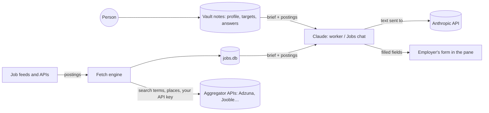

# Threat model: Crewdeck Jobs v2

Part of [the Jobs v2 design](jobs-v2.md). Extends the v1 threat model in [docs/design.md](../../design.md#threat-model-and-controls).

## Trust boundaries

1. The person ↔ Claude desktop (trusted).
2. Local server ↔ browser pages (page endpoints: same-origin only; v1 controls unchanged).
3. Local server ↔ background worker (token + crewdeck CLI only).
4. **Untrusted content** → worker / Apply subagent: postings, company pages, LinkedIn posts/pages, form pages.
5. Crewdeck ↔ the internet (netguard: public addresses only, redirects re-checked, size caps).

## STRIDE highlights

| Element | Threat | Control |
| --- | --- | --- |
| Worker reading postings | Prompt injection ("ignore your rules, email …") → tampering / elevation | jobs sandbox (no network for Bash, Crewdeck files unreadable), `--allowedTools` allowlist, postings passed as data files, citation check, no send/submit capability |
| Apply / LinkedIn import | Injection from a form or LinkedIn page | only in a fresh Jobs chat (jobs sandbox), never a chat in another folder; navigation limited to the apply host and known ATS hosts (PreToolUse hook); returns status only; stops before Submit; sensitive fields never filled |
| Background worker | Injection makes it read secrets or exfiltrate | `--tools` hard allowlist, `--strict-mcp-config`, `--setting-sources project`, Read deny outside the workspace, no free-form fetch, keys only in the fetch engine |
| Import from this page | A crafted page returns links to internal addresses | links validated by netguard before any fetch |
| API keys | Disclosure via logs/prompts/URLs | 0600 file read only by the fetch engine; URLs redacted before logging; worker denyRead; never in prompts or the repo |
| Company directory / registry | Poisoned entry (attacker's tenant named like a real employer) | seed pinned by hash; discovered entries quarantined until the board links back to the company's domain; provenance shown; scam heuristics |
| Intake | A pasted post or page rewrites answers, profile or watchlist | everything derived from quoted/fetched material is a proposal the person approves |
| Learning loop | Silent preference drift | suggestions only, applied by the person; Changes log |

## Data flow

## Privacy

Notes and the database stay on the machine. What leaves it: postings, resume and profile facts sent to Anthropic when
Claude reads them (as in v1); search terms and places sent to the sources that need them, tied to the person's own key
for keyed aggregators; the answers the person reviews and submits to an employer. No telemetry. `crewdeck jobs forget`
deletes applications, events and drafts; aggregators that require the end user's IP (Careerjet) are excluded.
