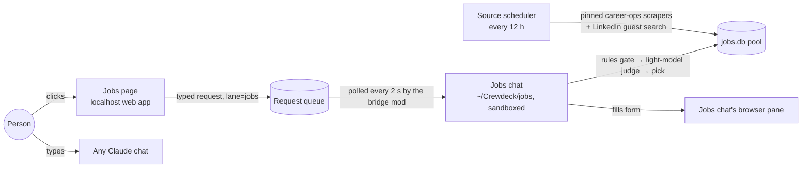
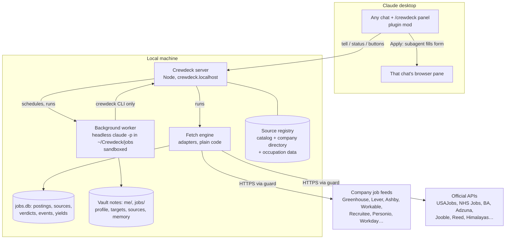

# Design Doc: Crewdeck Jobs v2 — a job search that works for anyone, anywhere

| Field | Value |
| --- | --- |
| Status | In review |
| Author(s) | Crewdeck maintainers (drafted with Claude) |
| Reviewers | Reliability · Security · Cost · Data · Operability · Devil's advocate |
| Approver | The maintainer (product owner) |
| Last updated | 2026-11-20 |
| Related ADRs | [0001](../adr/0001-source-planner.md) · [0002](../adr/0002-company-feed-index.md) · [0003](../adr/0003-eligibility-rules-occupation-scoring.md) · [0004](../adr/0004-background-worker.md) · [0005](../adr/0005-linkedin-user-driven.md) · [0006](../adr/0006-apply-in-current-chat.md) · [0007](../adr/0007-occupation-taxonomy.md) |
| Links | v1 design: [docs/jobs/design.md](../../jobs/design.md) · Crewdeck everywhere: [docs/everywhere.md](../../everywhere.md) · supporting: [cost](jobs-v2-cost.md) · [FMEA](jobs-v2-fmea.md) · [threats](jobs-v2-threats.md) |

## 1. Summary

Crewdeck Jobs v1 found **2 picks** for its maintainer on a day when LinkedIn showed 99+ suitable roles, and would give a
Bangalore AI engineer or a US-bound Australian nurse close to nothing. The cause is structural, not tuning: a fixed
catalog of ~140 mostly global-remote scraped boards (0 India boards, almost no non-tech fields), a strict title gate
that ran before any model read a posting (it dropped 92% of the pool), descriptions missing for 29% of roles, a
LinkedIn guest search that failed 5 of 5 times, and work routed to a separate chat the user couldn't see.

v2 makes Crewdeck **intent-driven**: the person says what they want in any form (a sentence, a LinkedIn post link, a
resume, "I'm switching to product management", "I'm a nurse moving from Australia to the US"); Claude turns it into an
occupation model (standard occupations, every alternate title, skills, licences, places, work rights). A **source
planner** — first a curated field × country → sources table, later nudged by measured yield — picks that person's top ~10 sources from a registry of legitimate sources — companies' own public job feeds
(Greenhouse, Lever, Ashby, Workable, Recruitee, Personio, Workday…; ~10,000 boards seeded from an open CC BY
directory), official and government APIs (USAJobs, NHS Jobs, Germany's BA, Adzuna, Jooble, Reed, Himalayas…), the
user's own careers pages, and LinkedIn pages the user is looking at — and keeps re-ranking them on proven yield. Hard
rules apply only to structured facts (where you may work, employment type, stated pay); everything else is scored. A
**background worker** (headless Claude Code, sandboxed like today's jobs workspace) runs the daily search, judges with
full descriptions, and prepares the top 10 so the person only reviews and clicks Submit — **Apply** opens a fresh, sandboxed Jobs chat in front of the person, already on that role, so the form fills where they are looking and never inside an unrelated (e.g. work) chat. Every action feeds a learning loop (sources, ranking, preferences).

Cost per user: no money of its own (local app, free public feeds, optional free API keys); **~0.25–0.4 M tokens/day**
of the user's Claude plan at 10 picks/day (§13). Biggest risk: the undocumented endpoints we lean on for big
employers (Workday) and legacy ATSes can change or block; mitigated by adapters behind one contract, honest
User-Agent, low rates, and graceful per-source failure. Reviewers: please challenge the planner's scoring, the
background-worker trust boundary (§11), and whether the phase order (§14) gets real users value early enough.

## 2. Context and problem

### 2.1 Current state (v1, as-is)



### 2.2 Pain points, with numbers (the maintainer's real run, 2026-11-20)

| Area | Number | Source |
| --- | --- | --- |
| Pool relevance | 2,161 roles fetched; **39** mention the user's country; 1,101 mention the US | jobs.db |
| Title gate | dropped **1,987 / 2,151** (92%); 21 clearly relevant titles lost (Full Stack Developer, SRE, DevOps, ML Engineer) | find.json, audit |
| Descriptions | **635 / 2,161** roles < 40 chars; all 400 from one board (HTTP 403 on detail); 318 truncated at 4,000 chars | jobs.db |
| LinkedIn | guest search **0 of 5** runs stored anything; stopped cards are discarded | sources.json, linkedin.ts:180 |
| Outcome | 25 passed rules → 7 "fit" (really 2 companies) → **2 picks** for a request of 10 | find.json |
| Coverage gaps | catalog has **0** boards for India; a Bangalore on-site user gets **0** suggested boards | sources-catalog.yaml, suggest.ts |
| Visibility | work ran in a chat the user couldn't find; Apply fills a form in that chat's pane | owner report, E14 |

### 2.3 Why now

The maintainer is about to rely on Crewdeck for a real job search and open it to the public. v1 can't serve a person
outside "remote tech, US/EU" — exactly the people the project says it is for ("Jobs for anyone", v0.4).

## 3. Goals and non-goals

| Goals (measurable) | Non-goals |
| --- | --- |
| G1. **Up to 10 picks a day, never padded**: for each of 8 acceptance personas (§15) ≥ 10 eligible relevant picks on ≥ 5 of 7 days where the field × country has legitimate coverage; otherwise an honest **coverage score** and the remedies (FR9) | Auto-apply or submitting for the user (Crewdeck never clicks Submit) |
| G2. **Precision ≥ 70%**: the person would consider ≥ 7 of 10 picks (measured by "Not interested" rate) | Scraping logged-in sites (LinkedIn, Indeed, Naukri, SEEK) or bypassing bot defences |
| G3. Intent → updated sources and a scan in **≤ 2 minutes** of saying it | A hosted Crewdeck cloud index (stays local-first) |
| G4. **Zero** chats to hunt for: everything except Apply runs in the background; status in the panel/page | Covering every job on earth: the planner picks the best ~10 sources per person |
| G5. Field or country change re-plans sources with no manual setup | Paid data vendors |
| G6. ≤ 0.4 M tokens/day per user at 10 picks; fetch ≤ 30 min and ≤ 100 MB/day | Windows (unchanged: later) |

## 4. Requirements

### 4.1 Functional

1. **Tell Crewdeck anything** (panel box, Jobs page box, or any chat via the skill): sentences, links (LinkedIn post,
   job posting, company page, careers page, search page), files (resume, cover letter). Claude classifies and applies
   it: profile fact, preference change, new target occupation, a job to consider, companies to watch, feedback.
2. **Occupation model**: each target maps to standard occupations (ESCO/ISCO, O*NET-SOC) with alternate titles in the
   person's languages, core skills, typical licences, seniority; multiple targets at once ("FDE or solutions engineer").
3. **Source planner**: picks the person's top ~10 sources from the registry, explains why, re-plans on intent change
   and weekly on yield; the person can pin, remove or add.
4. **Fetch**: per-source adapters (feeds, APIs, careers pages, user-provided pages), conditional requests, full
   descriptions, structured fields normalised to one JobPosting shape; dedupe; closed-job detection; scam flags.
5. **Match**: hard eligibility rules on structured facts only; occupation/skill/preference **scores**; model triage
   then full judging with the full posting; "unclear" resolved by fetching evidence, not shelved.
6. **Daily run** (scheduled, background): fetch → top up if thin → judge → pick N (default 10, one per company unless
   the person allows more) → **prepare** each (answers, tailored resume) → notify.
7. **Apply** from the Jobs page or panel: Crewdeck opens a fresh Jobs chat in front of the person on that role;
   Claude fills the form in its pane and stops before Submit.
8. **Learning loop**: applied / skipped (with reason) / replies / interviews / answer edits update memory, source
   yields, ranking weights, and suggested preference changes (shown, never silently applied).
9. **Edge cases as first-class fields** (schema v3 + persona tests): visa sponsorship and work rights (usually unstated → evidence from sponsor registers, never assumed); licences by jurisdiction and timing (e.g. NCLEX + state, AHPRA, QTS); shift / part-time / hourly pay periods; students (internships, graduate schemes on seasonal cycles); no resume (build one from answers); several targets at once (picks split by the person's weights); one-per-company relaxed for large hourly employers; closed-job checks for aggregator listings; scam re-listings; never re-suggest roles applied to elsewhere (the person tells Crewdeck or it reads the confirmation).
10. **Honest coverage**: when a field × country has thin legitimate sources, say so and offer the remedies (employer
   careers pages, LinkedIn page imports, optional API keys).

### 4.2 Non-functional

| Attribute | Target | How measured | Today (v1) |
| --- | --- | --- | --- |
| Yield | ≥ 10 relevant eligible picks/day for 8 personas | acceptance suite + maintainer's daily log | 2 (maintainer) |
| Precision | ≥ 70% picks "would consider" | 1 − Not-interested rate over 2 weeks | not measured |
| Intent latency | ≤ 2 min from statement to re-planned sources and first scan started | timestamps in the run log | manual |
| Daily run duration | fetch ≤ 30 min, judge+prepare ≤ 30 min | run log | ~5 min fetch, judge manual |
| Tokens | ≤ 0.4 M/day at 10 picks | worker usage report | ~0.15 M per Find (2 picks) |
| Network | ≤ 100 MB/day per user | adapter byte counters | ~20 MB |
| Politeness | ≤ 1 req/s per host, honest UA, robots honoured where it disallows our UA | adapter logs, fitness test | yes (scrapers) |
| Availability | local app; a source failing never blocks a run | per-source isolation tests | one 429 stops LinkedIn |
| Privacy | all personal data stays on the machine; nothing sent to third parties but the queries a source needs | threat model | yes |
| Compliance | source terms (attribution, no redistribution, per-user keys) recorded per source and enforced | registry lint | partial |

### 4.3 Constraints and assumptions

| Constraint / assumption | Owner to confirm |
| --- | --- |
| Local-first, MIT, inside Claude desktop (plugin + local server + browser pane) | maintainer (given) |
| The person always clicks Submit | maintainer (given) |
| A1. Background work runs as headless `claude -p` on the user's own Claude plan in the sandboxed jobs workspace (supersedes v1 D17). **Verified first in a P0 spike** (auth from Claude desktop's install, plan-limit behaviour, terms) before anything depends on it; if it fails, the worker is replaced by the v1 Jobs chat with the E14 surfaces | maintainer — ADR-0004 |
| A2. No Naukri/Indeed/SEEK scraping; India/AU coverage via company feeds, Adzuna/Jooble (optional keys), LinkedIn page import, employer pages | maintainer |
| A3. Optional per-user API keys (Adzuna, Jooble, Reed, USAJobs) offered in setup, never shipped | maintainer |
| A4. SmartRecruiters excluded (robots.txt disallows non-LinkedIn agents on `/v1/companies/`) | maintainer |
| A5. Company directory seed = LastRound AI ATS directory (CC BY 4.0, ~9.9k boards) + Common Crawl discovery, attributed | maintainer |
| A6. One maintainer, ~2–3 weeks of agent-assisted build for P1–P4 | maintainer |

## 5. Capacity estimates (per user; Crewdeck runs one user per machine)

| Quantity | Formula | 1x (typical) | 3x (heavy) | 10x (stress) |
| --- | --- | --- | --- | --- |
| Company boards watched | planner's company set | 300 | 900 | 3,000 |
| Feed requests/day | boards × 1 conditional GET (+ ~3% changed → detail) | ~310 | ~930 | ~3.1k |
| Fetch wall time | busiest host requests ÷ 1 req/s (Greenhouse ~50% share) | ~3 min | ~8 min | ~26 min |
| Bandwidth/day | 304s ≈ 0.5 KB, changed lists ≈ 10 KB, new jobs × 8 KB | ~5 MB | ~15 MB | ~50 MB |
| Other sources | ~6 API/board sources × ≤ 10 pages | ~60 req | ~180 | ~600 |
| New postings/day entering the pool | boards × ~15 jobs × 3% churn + API results | ~300 | ~900 | ~3,000 |
| After eligibility rules | ~20–40% pass structured place/type rules | ~90 | ~270 | ~900 |
| Model triage (light model) | 50 postings/batch × ~250 tokens summary | ~25 k tokens | ~70 k | ~225 k |
| Full judging | top 30 × ~3 k tokens (full posting + profile brief) | ~90 k | ~90 k (capped) | ~90 k (capped) |
| Prepare | 10 picks × ~12 k tokens (form read + drafting) | ~120 k | ~120 k | ~120 k |
| **Tokens/day** | triage + judge + prepare | **~0.24 M** | **~0.28 M** | **~0.44 M** (cap triage at 150 → ~0.3 M) |
| Storage/year | postings × ~12 KB (desc) kept 90 days + metadata | ~350 MB rolling | ~1 GB | ~3 GB (prune to 30 days) |

Judging and preparing are capped by the pick count, not by the pool, so tokens grow sub-linearly; triage is the
lever (cap and cache verdicts by posting hash).

## 6. Options considered

### Option A — Minimal change (tune v1)
Add synonyms to the title gate, fetch missing descriptions, fix LinkedIn card loss, add India entries as they appear in
career-ops upstream. **Pros:** small, low risk. **Cons:** keeps a fixed catalog of scraped boards; non-tech and
non-US/EU fields stay empty; invisible work stays. **Cost:** ~3 days. **Risk:** doesn't meet G1 for most personas.
Two-way door.

### Option B — Intent + source planner + registry of legitimate feeds + background worker (chosen)
As §1. **Pros:** meets G1–G6 with legitimate sources; adapts per person; no cloud. **Cons:** more moving parts
(adapters, directory, planner, worker); depends on undocumented-but-public endpoints for some big employers.
**Cost:** ~2–3 weeks; ~0.25–0.4 M tokens/day/user. **Risk:** endpoint drift. Mostly two-way (each adapter and the
planner are replaceable); the occupation model in the notes is a one-way-ish schema (versioned, migrated).

### Option C — Hosted shared crawler index ("Crewdeck cloud")
One central crawler of all ATS boards serving every user (the Jobright model). **Pros:** best coverage/freshness, cheap
per user. **Cons:** violates local-first/no-accounts, needs hosting money, ops, terms for redistribution (Himalayas,
Remotive forbid it), a privacy surface. **Cost:** servers + ops. One-way door (users depend on it).

### Option D — Agentic browsing every day
Claude browses the web per person (search engines, sites) daily. **Pros:** maximal reach, adapts naturally. **Cons:**
~5–10× tokens, slow, flaky, hits bot defences and site terms, hard to make repeatable. Two-way door.

### Decision matrix (1–5)

| Criterion (weight) | A | B | C | D |
| --- | --- | --- | --- | --- |
| Meets NFRs/goals (30%) | 1 | 4 | 5 | 3 |
| Operational complexity (20%) | 5 | 3 | 1 | 3 |
| Cost at 3x (20%) | 5 | 4 | 2 | 1 |
| Time to deliver (15%) | 5 | 3 | 1 | 4 |
| Reversibility / evolvability (15%) | 5 | 4 | 1 | 4 |
| **Weighted total** | 3.8 | 3.7 | 2.3 | 2.9 |
| **Gate: meets goals ≥ 3** | ✗ (1) | ✓ | ✓ but fails local-first | ✓ (3) but cost ×5–10 |

"Meets goals" is a **gate** before the weighted total: an option scoring ≤ 2 there is out, whatever its total. A
totals highest only because it is cheap and fast, and it fails the gate (it does not solve G1 for most personas); C
fails the local-first constraint. B is the only option that passes the gate within the constraints. **Decision:
Option B**, with A's quick wins shipped first as P1 (§14). Recorded in ADR-0001…0007; the agentic approach (D) is kept as a bounded **top-up** step inside B, not the
main path.

## 7. High-level design

### 7.1 Containers (C4 L2)



### 7.2 Components

| Component | Responsibility | Tech | Scales on | Stateful? |
| --- | --- | --- | --- | --- |
| Intake | Classify and apply anything the person tells Crewdeck; write notes with Changes log; trigger re-plan/scan | `jobs-intake` skill (worker or chat) + `crewdeck jobs tell` CLI | statements/day (few) | notes |
| Occupation model | Targets → occupations, alternate titles (per language), skills, licences, seniority | bundled O*NET (CC BY) + ESCO labels; `occupations.ts` | targets (1–5) | registry files |
| Source registry | All known sources with fields, countries, work modes, terms, key needs, adapter id, health | YAML catalog + company directory SQLite | ~200 sources + ~10k boards | yes |
| Source planner | v1: curated field × country × work-mode table → top ~10 (+ company set); v2 (P5): nudged by measured yield; explains choices | `planner.ts` + `data/source-plan.yaml` | sources × person | yields in db |
| Fetch engine | Run adapters with conditional GET, per-host pacing, retries, normalisation, dedupe, closed detection | `fetch/` adapters, netguard | boards/day | jobs.db |
| Matcher | Hard eligibility on structured facts; scores (occupation, skills, prefs, freshness, source prior) | `match.ts` | postings/day | verdict cache |
| Background worker | Daily run, intake, prepare; headless Claude with the jobs sandbox and least-privilege tools | `claude -p` launched by the server | 1 run at a time | run log |
| Apply | Open a fresh sandboxed Jobs chat per Apply (in front of the person); fill the form; stop before Submit | `claude://code/new` + `jobs-workspace` skill | per click | request |
| Learning loop | Events → memory, yields, weights, suggested preference changes | `learn.ts` + skills | events | db |
| Surfaces | Panel (status, picks, needs-you), Jobs page (picks, sources, why), Notes | plugin mod + web | — | — |

### 7.3 Key flows

**F1. Tell Crewdeck (happy path):** "Here's a LinkedIn post: these companies hire remote. Check if anything suits me."

```mermaid
sequenceDiagram
  actor P as Person
  participant Pn as Panel (any chat)
  participant S as Server
  participant W as Worker (headless)
  participant F as Fetch
  P->>Pn: paste link + sentence
  Pn->>S: POST /api/tell {text}
  S->>W: run jobs-intake (text as data)
  W->>W: read post via guarded fetch (public) or ask P to open it in the pane if it needs sign-in
  W->>S: crewdeck jobs watch add <companies>; jobs add-link <postings>
  S->>F: resolve each company's careers feed (detect ATS), fetch now
  F-->>S: new postings
  S->>W: judge new postings (full text)
  W-->>S: verdicts + 3 matches prepared
  S-->>Pn: "3 roles from that post fit you · 1 needs your notice period"
```

Failure path: the post requires sign-in → the worker can't read it → panel shows "Open the post in Claude's browser
pane and press Import from this page" (F4).

**F2. Change of direction:** "Now I want product manager roles." → intake adds a PM target (occupation codes, titles,
skills from the resume), asks 2 short questions (level, keep FDE too?), planner re-plans: drops engineering-only
boards, adds PM-heavy company sets and aggregators, scan runs; Preferences shows the new target with a preview.

**F3. Relocating nurse:** "I'm a registered nurse in Australia moving to the US next year." → occupation = Registered
Nurse (O*NET 29-1141, ISCO 2221); licence: needs a US state licence (NCLEX-RN) — intake asks "Do you have/plan NCLEX,
which states?" and "visa: need sponsorship?"; places = US states she names; sources = hospital-system Workday/Oracle
feeds in those states (company sets by industry=healthcare, region), USAJobs (VA nurses), Adzuna/Jooble US (optional
keys); eligibility rule: drop postings that require a licence she can't hold by the start date; score sponsorship
signals (EB-3 history registers).

**F4. LinkedIn page import:** the person pastes a LinkedIn post or search link (or presses **Import a LinkedIn page**) →
Crewdeck opens a Jobs chat with "Import jobs from <url>" → that chat opens the page in its pane (the person signs in
there if needed), reads only the visible DOM once (no scrolling, no paging, no navigation beyond the given URL), and
returns structured links/companies only → they enter as **proposals** (F1). The panel tells the person once that any
agent reading a signed-in LinkedIn page carries account risk under LinkedIn's terms.

**F5. Daily run + Apply:** 07:00 the server starts the worker → fetch (≤ 30 min) → triage → judge → pick 10 → prepare →
panel: "10 jobs ready". Person clicks Apply on one in the panel/page → Crewdeck opens a **new Jobs chat** (`claude://code/new`, jobs folder, prompt "Apply to <role id>"; Claude desktop shows it in front and asks once to confirm the folder) → the person presses Enter → the form fills in that chat's pane, under the jobs sandbox → "Your turn: review and Submit". Failure path: the site needs an
account → panel shows "Create the account in the form tab, then Continue".

### 7.4 Boundaries

- **Trust:** everything fetched (postings, pages, posts, form pages) is untrusted data; only the background worker and
  Jobs chats in `~/Crewdeck/jobs` read it, both under the jobs sandbox (§8.7, §11).
- **Sync/async:** intake and daily run are async (worker); panel/page poll status via SSE/`/api/today`; Apply is an
  interactive turn in the current chat.

## 8. Low-level design

### 8.1 APIs (local server; agent endpoints need the token, page endpoints need same-origin)

| Endpoint | Caller | Purpose | Notes |
| --- | --- | --- | --- |
| `POST /api/tell` | page, panel | `{ text, files? }` → queues an intake run | idempotency key = hash(text, minute); ≤ 20/min |
| `GET /api/jobs/runs` | page, panel | current/last worker runs with steps | SSE `runs` topic |
| `POST /api/jobs/sources/plan` | page | re-plan now; returns chosen sources + reasons | pure; no fetch |
| `POST /api/jobs/import-page` | panel (agent) | `{ url, links[], text }` from the visible page | links validated by netguard |
| `crewdeck jobs watch add|remove <company or careers URL>` | worker | company watchlist | detects ATS, validates feed |
| `crewdeck jobs tell --text-file <f>` | worker/chat | apply an intake decision set (JSON) | validated against note schemas |
| `crewdeck jobs run [--now] [--prepare N]` | server/worker | daily run steps | resumable by run id |

Error model: `{ error, fix? }`; timeouts: feeds 15 s, APIs 20 s, detail pages 15 s; worker step 10 min.

### 8.2 Data model (jobs.db additions; SQLite, migration v5)

| Table | Key | Fields | Access pattern |
| --- | --- | --- | --- |
| `postings` (replaces `roles` content) | `id` = hash(source_kind, board, ats_job_id) | title, company_id, url, apply_url, desc_text (full), desc_hash, locations[], workplace (remote/hybrid/onsite), remote_countries[], employment_type, pay{min,max,currency,period}, posted_at, updated_at, closes_at, occupation_codes[], language, scam_flags | by fetched_at desc; by company; by desc_hash (verdict cache) |
| `sources` | `key` | kind, adapter, params, fields[], countries[], modes[], terms{attribution, key_needed, redistribution}, health, last_ok, etag | planner scan; adapter run |
| `companies` (+ directory) | `id` | name, domain, ats, board_slug, industry, size_band, hq_country, hiring_countries[], seen_at | planner company sets by industry×region |
| `yields` | (person, source_key, week) | fetched, eligible, judged_yes, picked, applied, skipped | planner scoring |
| `verdicts` | (posting_id, profile_hash) | eligibility yes/no/unclear, score, reasons, evidence, model | judge cache |
| `runs` | `id` | kind (daily/intake/prepare), steps[], tokens, started, finished, outcome | panel/page status |

Retention: postings unseen 30 days and never picked → pruned; picked/applied kept.

### 8.3 Caching

Feed ETags/Last-Modified per board (`sources.etag`); verdict cache by (desc_hash, profile_hash); occupation lookups
in memory; company directory refreshed weekly from the shipped seed + discovery.

### 8.4 Messaging

Single-process job queue in the server (existing Requests, extended with `kind` = run step and `hold`); at-least-once
steps with idempotent effects (upserts by posting id; run ids). No external broker.

### 8.5 Consistency

Notes are the source of truth for the person's profile/targets/sources (atomic writes, Changes log, last-valid
fallback — unchanged). The db is a cache of the world + history; rebuildable except events.

### 8.6 Daily-run state machine

`queued → fetching → triaging → judging → picking → preparing → ready` (each step checkpointed; resumable;
`failed` with reason; `partial` if a step hit its cap). Top-up: if `eligible < 3 × N` after fetching, the planner adds
the next-best sources and widens the company set (bounded: +2 sources, +200 companies) once per run.

### 8.7 AI components

| Step | Model | Input | Tools | Guardrails |
| --- | --- | --- | --- | --- |
| Intake | default (Sonnet-class) | the person's text/files + notes | `crewdeck jobs propose` (writes a proposal file only), `crewdeck jobs fetch-page` (netguard) | the person's own words may apply directly; **anything derived from quoted or fetched material is a proposal the person approves** in the panel/page; nothing writes profile answers from fetched text |
| Triage | light model | ~250-token summaries | none | batch JSON schema; uncertain → judge |
| Judge | default | full posting + profile brief | none | evidence quotes required; preferences only score; "unclear" must name the missing fact |
| Resolve unclear | default | + company page / ATS detail fetched **by the fetch engine beforehand** | none (no free-form fetch) | max 1 evidence page per posting, chosen by code |
| Prepare | default | form read + facts | existing draft/cite pipeline | citation check (v1, unchanged) |
| Apply | default, in a fresh Jobs chat | the form page | the jobs workspace's sandbox + v1 rules; navigation limited to the posting's apply host and known ATS hosts (PreToolUse hook) | stops before Submit (v1 rule); sensitive fields never filled; returns status only |

Evals: a fixture set of ~400 labelled postings across the 8 personas (eligible/relevant) with target precision/recall
for triage+judge (≥ 0.85 recall on eligible-relevant at triage; ≥ 0.75 precision at judge).

## 9. Scalability and performance

Per machine, one user. Hot spots: Workday (no ETags, 20 per page, detail per job) → weekly or watchlist-only;
triage token use → capped and cached. Pacing per host (1 req/s; Lever `Crawl-delay: 1`), host-parallel. Load test:
the 10x row of §5 against recorded fixtures must finish fetch ≤ 30 min and tokens ≤ 0.45 M.

## 10. Reliability and resilience

- **SLOs (local):** daily run completes by 08:00 on ≥ 95% of days the machine is awake; any single source failing
  never fails the run; intake answers within 2 min on ≥ 95% of statements.
- **Failure modes:** see [FMEA](jobs-v2-fmea.md) — source down/slow/changed shape, rate-limited, robots change, worker
  crash, Claude plan limit hit, notes invalid, machine asleep at run time, duplicate floods, scam postings.
- **Patterns:** per-request timeouts; retries with jitter (max 2) on 5xx/timeout only; per-source circuit breaker
  (3 consecutive failures → skip for 24 h, panel shows it); backoff across runs on 429 (doubles, max 7 days); bulkhead
  per adapter; worker step checkpoints; degrade: no worker → page offers "Run in a chat" (v1 path).
- **DR:** jobs.db nightly SQLite backup (`.backup`, keep 7); notes are files (the user's own backups/sync).

## 11. Security and privacy

See [threat model](jobs-v2-threats.md) (revised after the 2026-11-20 security review). Key points:

- **Untrusted content** (postings, pages, posts, form pages) is read only by the background worker and by Jobs chats in
  `~/Crewdeck/jobs` — never by a chat in another folder. Apply and LinkedIn import always open a Jobs chat (ADR-0006).
- **Worker hardening** (ADR-0004): `claude -p --tools <allowlist>` (hard restriction, not just pre-approval),
  `--strict-mcp-config` with an empty MCP config, `--setting-sources project` (no user settings, plugins or hooks), no
  bypass permission mode; Read/Grep deny rules for everything outside the jobs workspace and Jobs' out/tmp (so
  `~/.ssh`, `~/.aws`, `~/.crewdeck/token` and `keys.json` are unreadable); Bash in the OS sandbox with only the
  `crewdeck` CLI let out (v1). No free-form fetch: the fetch engine fetches, through netguard, before the model runs.
- **Proposals, not writes:** anything derived from quoted or fetched material is staged as a proposal the person approves.
- **API keys** live only in the fetch engine's process: `~/.crewdeck/keys.json` (0600), denyRead for the worker,
  URLs redacted before any log line (Adzuna/Jooble put keys in the URL).
- **Company directory:** the shipped seed is pinned by hash; discovered entries stay in quarantine until the board links
  back to the company's own domain; every source shows its provenance; scam heuristics on postings.
- **Privacy, stated honestly:** notes and the database stay on the machine, but resumes, profile facts and postings are
  sent to Anthropic when Claude reads them (as in v1), and keyed aggregator queries tie titles/places to the person's
  key. A data-flow diagram is in the threat model; `crewdeck jobs forget` deletes applications, events and drafts.
- **Politeness and terms:** honest User-Agent; robots honoured for our UA and for `*`; a terms review recorded per
  adapter; undocumented endpoints (Workday, Oracle) flagged on Sources; one misbehaving adapter is disabled centrally by
  a registry update (the User-Agent's reputation is shared by every user).
- **Budgets:** a daily cap on worker runs (default 20) and tokens (default 0.5 M) per machine.

## 12. Observability and operations

Run log per worker run (steps, durations, tokens, counts, errors) shown on the page ("Last run") and kept 30 days;
per-source health (last ok, last error, yield) on Sources; `crewdeck doctor` checks worker, keys, registry age;
structured logs `~/.crewdeck/logs/worker.log`. No telemetry leaves the machine.

## 13. Cost

See [cost model](jobs-v2-cost.md). Money: $0 (local; free public feeds; optional free API keys). Tokens: ~0.24 M/day
at 1x, ~0.3 M at 3x (capped); top driver = prepare (10 × ~12 k), then judge, then triage. Levers to cut 30%: prepare
only on demand (saves ~0.12 M), smaller judge batch with cached verdicts, triage cap.

## 14. Migration and rollout

| Phase | Ships | Exit criteria |
| --- | --- | --- |
| **P0 Spike (done 2026-11-20)** | headless `claude -p`: not signed in outside Claude desktop's chats → no server-started worker; work runs on demand in a Jobs chat opened in front (ADR-0004, revised); a scheduled daily run later | decision recorded |
| **P1 Quick wins (≈3 days)** | occupation synonyms + auto-migrate v1 `roles.titles`; eligibility-only hard rules, title as score; full descriptions for every rule-passing posting (no 4,000-char cut, retry, board-specific fetchers); keep LinkedIn cards; funnel counts by company; "up to 10, never padded" + coverage score | maintainer's same pool: ≥ 3× eligible relevant postings; tests green |
| **P2 Sources for every field (≈6 days)** | curated **field × country → sources table**; official APIs: USAJobs, NHS Jobs, DfE Teaching Vacancies, BA Jobsuche, Reed, Adzuna, Jooble (optional per-user keys, setup asks); company feeds: Greenhouse, Lever, Ashby, Workable, Recruitee, Personio, Teamtailor, Breezy, **Darwinbox, Keka, Zoho Recruit** (India), Workday **daily for watchlisted** employers, weekly otherwise; company directory (pinned seed + quarantine); hospital/school/enterprise company sets | each persona on **one week of live data, labelled by a real person in that field**: ≥ 10/day where coverage exists, or a truthful coverage score |
| **P3 Tell Crewdeck (≈3 days)** | `/api/tell` + panel/page box + `jobs-intake` skill with proposals; LinkedIn post/page import via a Jobs chat; watchlist by company name; re-plan on intent | F1–F4 end-to-end on the maintainer's machine |
| **P4 On-demand runs in front + Apply (≈3 days)** | Find / intake / Apply open a Jobs chat in front; prepare when a pick is opened; panel and page show progress and results; the scheduled daily run is a later opt-in | no chat to hunt for (G4) |
| **P5 Learning loop (≈2 days)** | yields nudge the planner; skip reasons → suggested rules; precision tracking | precision ≥ 70% over 2 weeks |

Rollout: behind `jobs.v2` flags per phase on the maintainer's machine first; v1 paths stay until P4 passes; notes
migrations are additive and logged under Changes; rollback = turn the flag off (db v5 is additive).

## 15. Testing strategy

Unit (adapters on recorded fixtures, planner scoring, rules, migration); contract tests per adapter against recorded
real responses (refreshed monthly, failing loudly on shape change); integration (daily run on fixture world); **8
acceptance personas** (fictional, in the repo): remote engineer eligible from India; AI engineer on-site Bangalore; PM
career-changer India; RN Australia→US; UK teacher; Germany accountant (German); US warehouse worker (no resume);
freelance translator EU — each with a labelled fixture pool and yield/precision targets; AI evals (§8.7); UI tests
(existing a11y/small-window); leak scan.

## 16. Fitness functions

| Rule | Tool | Where | Fails when |
| --- | --- | --- | --- |
| Every source has terms, fields, countries, adapter | registry lint (node test) | CI | a field is missing |
| No adapter hits a host faster than 1 req/s | pacing test with fake clock | CI | two requests < 1 s apart |
| No hard drop on title or soft preferences | rules test | CI | a rule outside the eligibility list drops a posting |
| Worker tools are the allowlist | settings test | CI | an extra tool or unsandboxed Bash appears |
| Persona yield floors | acceptance suite on fixtures | CI (weekly) | a persona < 10 eligible relevant |
| No personal data in the repo | leak scan | pre-commit, CI | a finding |

## 17. Risks, dependencies, open questions

| Item | Type | Impact | Owner | Due |
| --- | --- | --- | --- | --- |
| Workday/Oracle endpoints are undocumented and may change | risk | big-employer coverage (hospitals) drops | maintainer | contract tests monthly |
| Company directory goes stale (boards move ATS) | risk | yield decays | maintainer | weekly validation + discovery |
| Headless `claude -p` availability/limits on the user's plan | dependency | daily run delayed | maintainer | P4 spike |
| LinkedIn page import misread as automation by LinkedIn | risk | account warnings | maintainer | user-triggered only, one page |
| India/AU thin legitimate coverage | risk | G1 for those personas relies on company feeds + keys | maintainer | P2 measure |
| Should Prepare run for all 10 picks daily or on open? | question | tokens vs. speed | maintainer | P4 |
| Adzuna free tier is "for evaluation" | question | key-based source viability at scale | maintainer | P6 |

## 18. Review log

| Date | Reviewer / lens | Verdict | Key findings | Resolved in |
| --- | --- | --- | --- | --- |
| 2026-11-20 | Devil's advocate (pre-design audit) | 1/5 on v1 topology | invisible work, sourcing ceiling, rules-before-judge, cluttered surfaces | ADR-0001…0006 |
| 2026-11-20 | Devil's advocate (design) | 1 → revised | non-tech/non-US coverage unproven; P2 exit needed P6 sources; headless spike late; G1 vs precision; missing edge cases; self-labelled fixtures; no revisit triggers | G1 reworded; P0 spike; official APIs + India ATSes + Workday daily into P2; static table first; edge-case fields (FR9); live labelled week; revisit triggers in ADRs |
| 2026-11-20 | Security | 1 → revised | subagent allowlist isn't isolation (Apply in a work chat); `--allowedTools` doesn't restrict; intake writes from fetched text; directory poisoning; keys in URLs/logs; privacy claim | Apply/import only in Jobs chats; hardened headless flags + Read deny; proposals; pinned seed + quarantine; key redaction; honest privacy + forget |

## Appendix — evidence

- Audits (2026-11-20): coverage, matching/judging, UX/IA, architecture — summarised in §2.2.
- Competitor study: Jobright (company career sites + boards, skill-based match), LoopCV (boards, dedupe), Simplify /
  Teal / Careerflow (user-driven clipping + autofill), Weekday (approve-first, India), LazyApply/AIApply (bans,
  irrelevant auto-applies: what to avoid).
- Sources: Greenhouse/Lever/Ashby/Workable/Recruitee/Personio feeds probed 2026-11-20 (ETag 304 on Greenhouse and
  Lever); SmartRecruiters robots disallow; LastRound ATS directory (CC BY 4.0, 4,966 Greenhouse / 2,856 Ashby / 2,113
  Lever boards); government APIs (USAJobs, NHS Jobs, BA Jobsuche, France Travail), aggregators (Adzuna ~19 countries
  incl. India, Jooble 60+, Reed UK); taxonomies O*NET (CC BY database) and ESCO (multilingual alternative labels).
