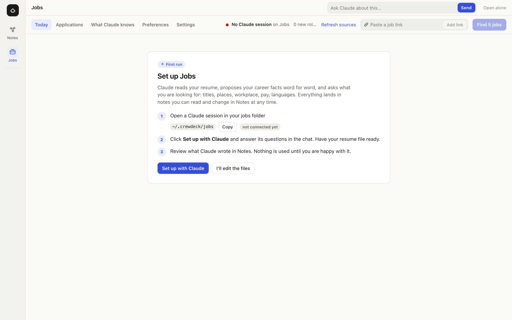

# First run: from zero to your first application (v2)

This walks a brand-new user through Crewdeck Jobs on a Mac, in the Claude desktop app, one step at a time. Each step
says what you do, what you should see, and what to do if you don't. It takes about 30 minutes, most of it the
interview with Claude. Linux works the same way (the differences are noted).

You type commands in a terminal (or ask Claude to run them for you, step 1). `crewdeck …` below means
`node src/cli.ts …` run in the folder where you cloned Crewdeck (or `crewdeck …` itself after `npm link`). Paths are the
defaults; yours differ if you passed `--vault` or changed the config.

**What you need:** a Mac (or Linux) computer, the [Claude desktop app](https://claude.ai/download) with a plan that
includes Claude Code, an internet connection, and your resume if you have one (no resume is fine too).

## 0. Starting fresh if you used Crewdeck before

Skip this if you never ran Crewdeck. To start over as a brand-new user, move your old data aside. **Never delete it**:
these moves are backups you can put back.

1. Stop the running Crewdeck: `crewdeck service uninstall` if it runs in the background (`crewdeck service status`
   says), else Ctrl-C in the terminal where `crewdeck up` runs (or stop it where Claude started it).
   `curl -s -o /dev/null -w '%{http_code}\n' http://localhost:4848/` should then print `000`.
2. Move the old Crewdeck home, vault and jobs folder aside:
   ```bash
   mv ~/.crewdeck ~/.crewdeck.backup-$(date +%Y%m%d)
   mv ~/Crewdeck/vault ~/Crewdeck/vault.backup-$(date +%Y%m%d)
   mv ~/Crewdeck/jobs ~/Crewdeck/jobs.backup-$(date +%Y%m%d)
   ```
   (If your vault was elsewhere, `vault:` in the old `config.yaml` says where; the jobs folder is `jobs.workspace`.)
   To go back later: stop Crewdeck, move the new folders aside the same way, and move the backups back to their names.
3. The plugin: if `claude plugin list` shows `crewdeck@crewdeck` installed from this same checkout, keep it (`crewdeck
   setup` updates it to this checkout's version and says "the crewdeck plugin is installed and up to date"). If it shows the old `crewdeck-bridge`, or a `crewdeck`
   marketplace from somewhere else, remove them first (the new marketplace has the same name):
   ```bash
   claude plugin uninstall crewdeck-bridge@crewdeck
   claude plugin marketplace remove crewdeck
   ```

Your project repos keep their boards (`backlog/` lives in each repo); add them again with `crewdeck add-project`.

## 1. Install

**The easy way: let Claude do it.** In the Claude desktop app, start a new session in the **Code** tab (pick your home
folder) and paste the prompt from the README's "Let Claude install it". Claude checks git and Node, clones Crewdeck
into `~/crewdeck`, runs `npm ci` and `crewdeck setup`, explains each step and asks before running anything. Then skip
to step 3.

**By hand:**

```bash
git clone https://github.com/pulkitnagpal/crewdeck.git
cd crewdeck
npm ci
```

**You should see** npm finish with "added … packages" and no errors. (To try a branch that isn't merged yet:
`git switch <branch>` before `npm ci`.)

**Node.** `node --version` must say v22.18 or newer, and **v25 or newer to fetch from job boards** (from 25, Node can
run the boards' third-party code with no network access of its own). On 22 or 24 everything else works and fetching
says why it doesn't. On a Mac: the installer from [nodejs.org](https://nodejs.org) ("Current"), or `brew install node`
if you use Homebrew. **git:** macOS offers to install it (the command line developer tools) the first time you type
`git`; accept.

**If not:** on a Node older than 22.18, npm warns `EBADENGINE` and Crewdeck's commands fail to start: install a newer
Node and run `npm ci` again.

## 2. Set everything up (one command)

```bash
crewdeck setup --service
```

`--service` keeps Crewdeck running in the background from now on and starts it when you log in (no admin password;
`crewdeck service uninstall` removes it). Without it (`--no-service`), you start Crewdeck yourself in step 3.
(`--vault <path>` puts your notes somewhere else. `--preset <name>` still exists for one release but is deprecated:
setup with Claude proposes sources from your own profile.)

It does, in order:
- **Crewdeck's home** `~/.crewdeck/` (private: config, the bridge token, SilverBullet, the tracker) and **your vault**
  `~/Crewdeck/vault`: your notes.
- **Jobs:** the five job notes in the vault (empty templates for the interview to fill), the private tracker in
  `~/.crewdeck/jobs/`, and the job-board providers (downloaded from a pinned commit and checked file by file).
- **Your jobs folder** `~/Crewdeck/jobs`: the folder you open a Claude session in to work on Jobs. Crewdeck writes a
  `CLAUDE.md` (the hard rules) and `.claude/settings.json` (Claude Code's sandbox) there and rewrites them on every
  start, so don't edit them.
- **The `crewdeck` plugin** in Claude (from this checkout): `/crewdeck` in any session, the bridge that brings your
  clicks on the Jobs page into the jobs session, and the Jobs skills.
- With `--service`, **the background service** (a LaunchAgent on a Mac, a `systemd --user` unit on Linux).

**You should see** (with your own paths):
```
Setting up Crewdeck…
Downloading SilverBullet 2.12.1…
Installed /Users/you/.crewdeck/bin/silverbullet
Vault ready: /Users/you/Crewdeck/vault
✓ Jobs is on (/Users/you/.crewdeck/config.yaml)
✓ /Users/you/.crewdeck/jobs (private), tracker jobs.db (schema v4)
✓ job notes ready for setup to fill in: me/profile.md, me/career.md, jobs/search.md, jobs/memory.md, jobs/sources.md
✓ jobs workspace /Users/you/Crewdeck/jobs: CLAUDE.md and .claude/settings.json (managed: rewritten on every init and up)
✓ browser for reading forms and resume PDFs: Google Chrome
✓ job-board providers: 137 from career-ops-hq/career-ops@f3b043d (MIT), 166 files verified
✓ installed the crewdeck plugin in Claude (it loads in new sessions)
✓ Crewdeck runs in the background now, and starts when you log in (/Users/you/Library/LaunchAgents/io.crewdeck.server.plist)

Done. Now:
  1. Crewdeck is running at http://crewdeck.localhost:4848 (open it in any browser, or in Claude desktop's browser pane).
  2. In any Claude session, type /crewdeck for today's to-dos, jobs and tickets beside the chat.
  3. For Jobs: in Claude desktop, start a new Code session in the folder /Users/you/Crewdeck/jobs
     and say hello. Then click "Set up with Claude" on the Jobs page: Claude interviews you there.
```
Without `--service`, line 1 says to start Crewdeck with `crewdeck up` and leave it running.
Running it again is safe: it never overwrites a note you changed (those show as "kept your …").

**If not:**
- The SilverBullet download needs internet and `unzip`.
- "no Chromium-based browser": install Chrome, Chromium, Brave or Edge (or set `jobs.browser` in the config to its
  full path). Jobs needs one to read forms and print resume PDFs.
- The providers line failed (offline, GitHub down): pasted links still work; run `crewdeck jobs providers install`
  later.
- The plugin line failed: "claude is not on PATH" means Claude Code's command line isn't installed; in Claude desktop
  use + → Plugins → Add marketplace with the path of your checkout, then install `crewdeck`. "a marketplace called
  crewdeck is already added from somewhere else": see step 0.3, then run `crewdeck setup` again.

`crewdeck doctor` checks everything; until the next step its last line is "✗ Crewdeck isn't running on port 4848".
If it says "✗ another Crewdeck answers on port 4848 (its notes: …), not this one", an older Crewdeck is still running:
stop it (step 0.1).

## 3. Open Crewdeck and the Jobs tab

With the background service, Crewdeck is already running: go to **http://crewdeck.localhost:4848** in any browser, or
in the Claude desktop app's Code tab ask Claude to "open Crewdeck" (it opens the page in the browser pane). In any
session, `/crewdeck` opens a panel beside the chat with today's to-dos, what Jobs waits on and your tickets.

Without the service, either:
- **From a terminal:** `crewdeck up` (with Node 25 for job-board fetching). It prints
  `Crewdeck on http://crewdeck.localhost:4848  (notes: …; projects: none yet)` and keeps running; leave that window
  open. Then open that address as above.
- **From Claude:** type `/crewdeck`, or ask "open Crewdeck": it starts Crewdeck in the background and opens it.

Click **Jobs** in the rail on the left.

**You should see**, in the same light or dark as Claude:
- the tabs **Today · Sources · Applications · What Claude knows · Preferences · Settings**, and **Find 5 jobs** greyed
  out (it waits for setup);
- under them, **No Claude session** on Jobs, **No sources yet** with **Open Sources**, and **Paste a job link**;
- on Today, the **Set up Jobs** card: four steps, your jobs folder with **Copy** and "not connected yet", and the
  buttons **Set up with Claude** and **I'll edit the files**.



**If not:**
- `EADDRINUSE`: something else uses 4848 or 4849 (an older Crewdeck?). Stop it, or change `port` and
  `silverbullet.port` in `~/.crewdeck/config.yaml` (and the plugin's `port`).
- Notes is blank: wait a few seconds on the first start (it indexes the vault). The browser pane logs a service worker
  error for Notes; that is harmless.

## 4. Open a Claude Code session in your jobs folder

In Claude desktop's Code tab, start a **new** session and pick the folder `~/Crewdeck/jobs` in the folder chooser (the
setup card shows the full path; **Copy** puts it on your clipboard). Trust the folder when Claude Code asks, then say
hello.

**You should see** within a few seconds: the session's status line reads `Crewdeck · jobs`, the card's "not connected
yet" turns into **Claude connected**, and the top bar says **Claude connected**.

**If not:**
- Still "No Claude session": `claude plugin list` must show `crewdeck@crewdeck` enabled, with the plugin's `port` equal
  to Crewdeck's. A session started before the plugin was installed doesn't have it: start a new one (or restart the
  Claude app). Send any message to wake the session: the bridge checks in every few seconds.
- "Crewdeck: server failed its identity check": Crewdeck isn't running on that port, or it restarted with a new token.
  Start it, then send a message.
- Linux: Bash refuses to run in this folder without `bubblewrap` and `socat` (the jobs folder's sandbox): install them.

## 5. Set up with Claude (the interview)

Click **Set up with Claude**.

**You should see** a toast in the session ("Crewdeck: 1 request for jobs") once it is idle, and Claude starts the
`jobs-setup` interview in that chat; the card says **Claude is setting up Jobs with you in the chat**. Answer in your
own words and your own language. Claude proposes, you confirm; it writes nothing you didn't say yes to.

If you clicked before the session was open, the card says **Waiting for a Claude session** ("No Claude session is
connected yet…"): open it (step 4) and the setup starts there by itself, or click **Cancel**.

The interview, in order:
1. **Your work.** *With a resume:* give its path, or drop the file into `~/Crewdeck/vault/raw/` (PDF, Word export,
   Markdown or text). Claude reads it as data and proposes your resume sections and **facts**, word for word, one per
   bullet. *Without one:* Claude asks about every job you have done, paid or not (employers, a family business, gig
   work, caring, volunteering), and writes facts from your answers after you confirm each. Starting out, changing field
   or coming back after a break each have their own path (projects and internships; a new field with its skills; a
   career break shown as a break).
2. **Who you are:** name, contact, links, education, standard answers such as your notice period and right to work.
   It never stores ID, bank or tax numbers (you type those into forms yourself).
3. **The kinds of job you want**, in your words, with the titles postings use (in every language you would work in),
   your level, where (cities, or where you can work remotely from; cities you would move to), workplace, and how you
   work (employment types, shifts, hours).
4. **Where to look.** Claude runs `crewdeck jobs sources suggest`, tells you the coverage line in plain words ("17 job
   boards fit remote work from India…", or "Crewdeck has no job board that fits United States for healthcare…" and what
   still works), and asks which employers you would like to work for: it checks each careers page. LinkedIn can be
   placed in your list; switching it on stays yours (step 13).
5. **Fetch once, then preview.** It fetches the new sources once (it can take a few minutes) and shows what your
   choices catch on real postings: how many pass, per kind of job, the near misses and why postings drop. It proposes
   changes (title variants, for example) and previews each before writing it. With nothing fetched yet (no providers,
   Node < 25, or no board for your field) it says so and moves on; paste links later.
6. **The rest:** pay floor (currency and period: a year, a month, a day, an hour), languages and levels, licences, what
   to exclude, daily picks, time zone, and the cooldown after applying.
7. **Check:** `crewdeck jobs check`, and a closing line from the real numbers.

Claude may ask permission for its first commands: it runs `~/.crewdeck/bin/crewdeck jobs …`, the one command its
sandbox lets out. Once your profile has a first name and your search at least one kind of job, the card gives way to
**Today**.

What it wrote, in your vault (open them in **Notes**; edit anything):

| Note | Now holds |
|---|---|
| `me/profile.md` | Who you are, links, education and standard answers |
| `me/career.md` | Resume sections and the fact bank |
| `jobs/search.md` | What you want, and a **Changes** log starting today |
| `jobs/sources.md` | Where to look, in priority order |
| `jobs/memory.md` | Empty until you tell Claude things along the way |

**If not:** requests arrive only when the session is idle; if Claude stops, the card says why and **Set up with
Claude** works again.

## 6. Review your sources

Open **Sources**. **You should see** the coverage line at the top (what is covered for you, and what isn't), then
**Yours**: your sources in order, each with its last fetch ("Not fetched yet…", "34 roles, 12 new, 10 kept by your rules · 2 h ago", or
what went wrong). Use **Move up** / **Move down** to change the order (the first is fetched first and its roles rank
a little higher; order never changes what your rules drop), the switch to stop fetching one without removing it, and
**Remove**. Below: **Add a company** (its name and careers page, then **Add and check**: Crewdeck checks which system runs it, for
example "Workday: 20 roles on a one-page test", or offers **Ask Claude** to find its real jobs page), **Add a web
address**, and the
**Catalog** (filter by region, field and kind; **Add** puts a source at the end).

## 7. Review your preferences

Open **Preferences**: kinds of job (name, titles and variants, skills), title matching, level, where, how you work,
pay, languages, exclusions and daily picks. Change anything and the **Preview** panel shows what the change would catch
on postings already fetched ("46 pass (now 31)") before you click **Save**. Saving logs each change under **Changes**
in `jobs/search.md`, like telling Claude.

## 8. Find jobs

1. The top bar shows "N new roles since …". Crewdeck fetches every 12 hours (`jobs.fetch_every`); **Refresh sources**
   fetches now. Fetching is plain code: no tokens. Your rules then drop what clearly doesn't fit, and the rest is
   ranked by title, skills, freshness and your sources' order.
2. Click **Find 5 jobs** (5 is your daily picks). Claude judges candidates best first, in batches of 10, and stops once
   5 pass; at most 40 postings per Find. Progress lines show on the page.
3. The picks appear in **Today**, one per company, each prepared as in step 9.

**Why so few?** When a Find picks fewer than you asked for, Today shows the funnel ("1,480 fetched → 202 passed your
rules → 10 judged → 3 fit"), the rule that dropped most, the sources that returned nothing, and one-click changes to
try ("Add 5 title variants: 186 more pass"). A change opens Preferences filled in, with its preview; nothing is saved
until you click **Save**.

**If not:** "Job boards not set up": `crewdeck jobs providers install`. "needs Node 25 or newer": restart `crewdeck up`
with Node 25. "No fetched roles are waiting to be judged": click **Refresh sources** first, or paste links.

## 9. Paste a link, and Prepare

Copy the link of any posting (the company's own careers page works best) into **Paste a job link** and click **Add
link**. **You should see** "Link sent to Claude", then Claude working: it reads the posting, adds the role, picks it
for today and **prepares** it:

- it reads the application form (headless, or in a background tab of the pane for forms that need a real browser) and
  notes the form's language: answers are drafted in that language, citing your facts (through translations you
  approved when the form isn't in your facts' language);
- it fills what your profile and memory already answer and drafts the rest from your facts (each answer shows its
  sources); anything it can't support becomes a **first-time question** for you;
- sensitive questions (salary expectations, date of birth, gender, nationality…) are yours to answer; ID, bank and tax
  numbers are never filled or stored: you type them into the form yourself;
- it renders a tailored resume PDF from your facts (in the language and conventions you chose).

First-time questions sit at the top of the role, marked **First time**. Answer each on the page or in the chat: it is
remembered in `jobs/memory.md` with your words and reused on later forms. **Edit** changes any answer; **Ask Claude**
asks for a rewrite (still cited). **Not interested** asks why and remembers your words.

**If not:** a warning (cooldown, already applied, a role at that company in progress): **Add it anyway** is your call
on the page. "Pasted LinkedIn links are off": see step 13, or paste the company's own posting.

## 10. Apply. You click Submit

Click **Apply**. The apply panel goes through its steps:

1. **Waiting for Claude**, then **Claude is filling the form**: Claude opens the real application in a new tab of the
   browser pane, next to Crewdeck. **Open the form** brings that tab to the front.
2. **What Claude did** lists each step ("Step 1 of 2: filled 4 fields from your answers").
3. A question Prepare didn't see comes back as **Claude needs your answer**; answer it and Claude continues.
4. **Your turn: review the form tab and click Submit.** Claude stops at the review page. It never clicks Submit.

Check every field in the form tab, attach the resume if the site needs an upload (the panel shows the PDF with
**Download** and **Show in Finder**), and **click Submit yourself**. Then click **I submitted it** in Crewdeck (or
**Mark applied** when Claude saw the confirmation page). **You should see** the role marked **Applied**, an "Applied to
…" line in today's journal note, and the company (or, if you chose so, that role) in its cooldown.

Some employers don't use a web form. The panel says so: **Apply in person** (where and when, from the posting, and the
answers to take; then **I applied in person**), an email or a document (the answers to copy), or **This site needs an
account** (create it yourself in the form tab, sign in, then **Continue**: Claude never creates accounts).

**If not:** **Claude stopped** with a reason (sign-in, CAPTCHA, "restricted", a limit): do that part yourself in the
form tab, then **Try again**, or finish the form by hand. Stuck with no progress: **Cancel**; a request whose session
stops answering goes back to the queue after 15 minutes.

## 11. What's stored where

- **Your knowledge: notes in your vault** (`~/Crewdeck/vault`), plain Markdown you can read, edit and back up:
  `me/profile.md`, `me/career.md`, `jobs/search.md`, `jobs/memory.md`, `jobs/sources.md`, and a line per application in
  `journal/`. Nothing about you lives anywhere else.
- **Crewdeck's machine state: `~/.crewdeck/`** (private to you): `config.yaml` (ports, appearance, your risky
  switches), `jobs/jobs.db` (roles, form questions, prepared answers), `jobs/out/` (resume PDFs, scratch files),
  `jobs/providers/` (the job-board code), `jobs/state/` (each source's last fetch, the last Find).
- **Your jobs folder: `~/Crewdeck/jobs`**: only where the Jobs session runs; Crewdeck rewrites its two files on every
  start.

## 12. Change a preference

In any Claude session, say what changed: "I'm OK with hybrid now." **You should see** Claude run `crewdeck jobs pref set
workplace …` with your words, then offer to re-check roles dropped in the last 14 days (`crewdeck jobs refilter --days
14`). In Notes, `jobs/search.md` has the new value and a line under **Changes**. Preferences shows it too, and the next
Find uses it.

## 13. Turn LinkedIn on (optional)

LinkedIn's terms forbid automated access; turning these on can get your IP rate-limited or your account restricted.
Read the README's "Safety and terms of service" first.

1. Jobs → **Settings** → the switch for LinkedIn guest search or pasted LinkedIn job links, then **Yes, switch it on**
   (or **Switch on…** on LinkedIn's row in **Sources**).
2. **You should see** your computer's own dialog asking you to confirm. Click it. The switch turns on.
3. Or in your own terminal: `crewdeck jobs features linkedin_links on` (it asks you to type `yes`, then shows the same
   dialog).

Switching off never asks. Claude can't change these switches.

## 14. Start over safely

To redo the whole first run (to test, or to start a new search from scratch), follow step 0: stop Crewdeck, then
**move** `~/.crewdeck`, `~/Crewdeck/vault` and `~/Crewdeck/jobs` aside with a date suffix. Never delete them; to go back,
move them back. To redo only the interview, keep everything and say "redo my job search setup" in the jobs session: the
setup skill runs again over your current notes, and Claude writes only what you confirm (each change to
`jobs/search.md` is logged under **Changes**).

## Known gotchas

- **Notes in the wrong theme** (light while the rest is dark, or the other way) on the first load after an older
  Crewdeck: reload the page once; it then follows Claude's light/dark.
- **`crewdeck.localhost`** works in Chrome, Edge, Brave, Firefox, Safari and Claude's browser pane with nothing set up.
  An address without the port is optional: `crewdeck address --short` (your admin password, once).
- **The plugin loads only in new sessions.** A session that was open before `crewdeck setup` never connects: start a
  new one in `~/Crewdeck/jobs`.
- **Requests wait for an idle session.** While Claude is answering you, page clicks queue up ("Waiting for Claude");
  they start when it finishes.
- **The first fetch takes minutes** and needs Node 25. Until something is fetched, the preview and Find have nothing
  to work with; pasted links always work.
- **An older Crewdeck still running** keeps port 4848: `crewdeck doctor` says "another Crewdeck answers on port 4848".
- **Fields with no job board** (nursing in the US, retail in India, logistics in Texas, translation…): the coverage line
  says so. Add the employers you want by their careers pages, and paste postings you find.
- **The page is in English**; Claude talks with you in your language, and answers forms in the form's language.

## Done

You have notes Claude wrote with you, sources you chose, an application you submitted yourself, and a search that
learns from what you say. `crewdeck doctor` checks the setup any time; the README's Troubleshooting table covers the
usual problems.
