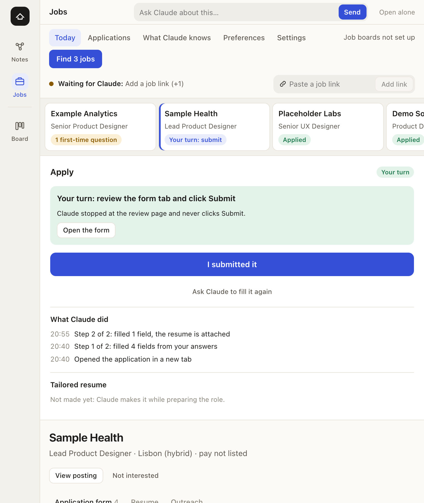
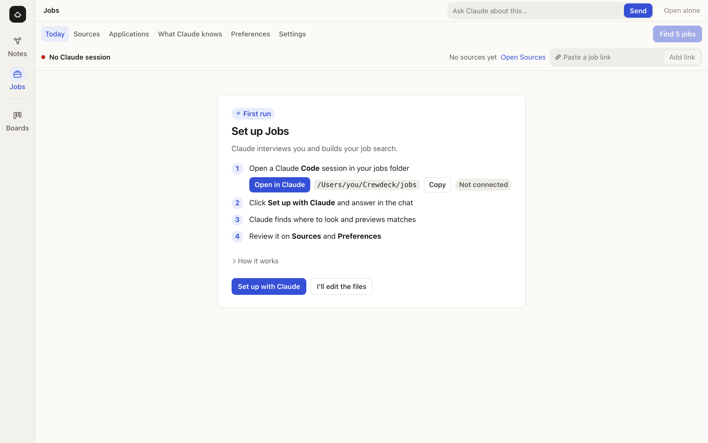
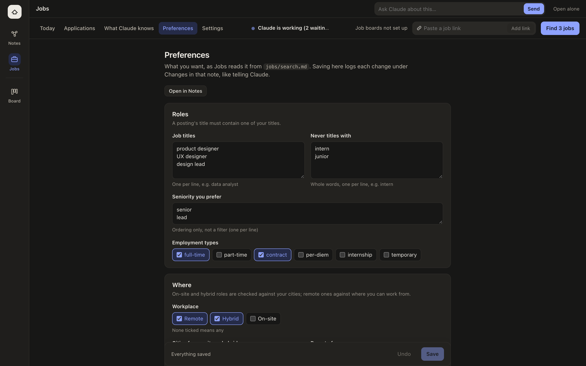
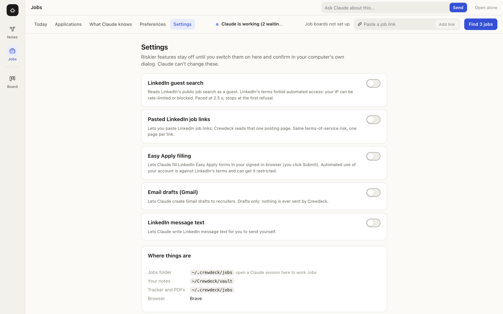
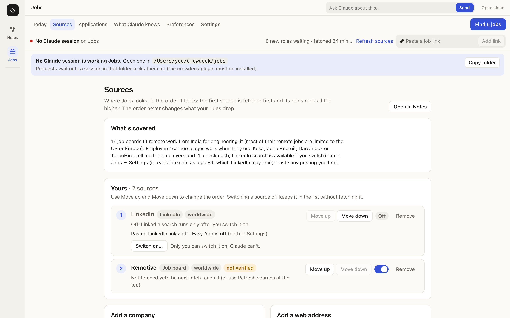
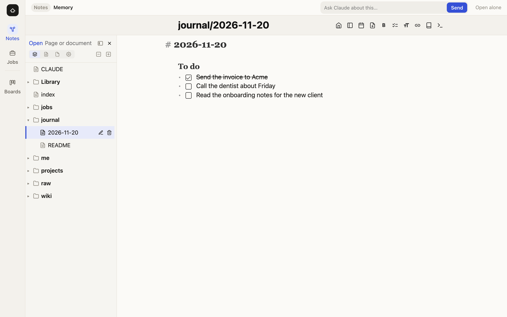
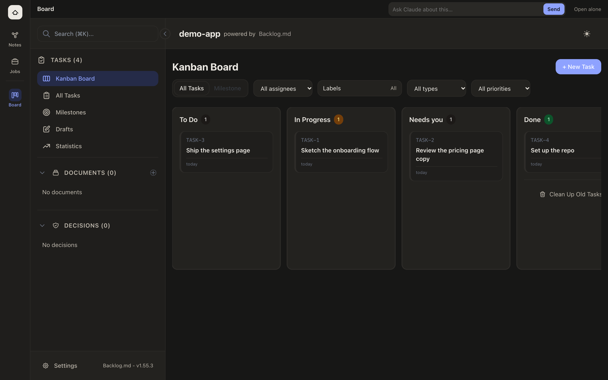

# PR: Jobs — a job search for anyone, in Crewdeck

Branch `feat/jobs-module` → `main`. Not opened and not pushed: the owner decides after the acceptance run.

## Summary

Crewdeck gains **Jobs**, a first-party module for a job search in any role and any country, next to Notes and Boards in
the same rail and theme. Claude interviews the user once and writes their notes; it finds roles within a token budget,
reads a posting the user pastes, prepares every answer from the user's own facts and words, and fills the real
application form in a tab of Claude desktop's browser pane. **The user clicks Submit; Crewdeck never submits.** Everything
Claude knows about the user is a note in their vault they can read and edit; machine state stays in `~/.crewdeck/jobs`.
The repo contains no personal data, and a leak scan enforces it.

**v0.4, Jobs for anyone** (P9a–P9i) followed the owner's first run, which found 1 role in 1,480 postings: the search had
been built around one person. An audit walked every step as nine fictional people (a nurse on nights in Ohio, an
accountant in Berlin, a store manager in Pune, a new graduate in Manila, a warehouse worker without a resume, a
freelance translator in Spain…), and v0.4 fixes what each hit: where to look comes from a catalog and the user's
notes, with an honest coverage line; titles match in any word order, language and form; every change can be previewed
on real postings; a small Find explains itself; the interview works with or without a resume; pay, shifts and forms
work in any period and language; and the whole page meets a 14 px minimum and AA contrast.

On the way, the existing shell got a security baseline and a full security review: SilverBullet moved to a private Unix
socket, the bridge proves the server before sending its token (which now rotates), the jobs workspace runs Claude's
shell in Claude Code's sandbox, and risky switches need the user's own click in a native dialog.

## Contents

- **Notes and rules** (`src/jobs/notes.ts`, `schema.ts`, `rules.ts`, `places.ts`, `pay.ts`): schema v1 for
  `me/profile.md`, `me/career.md`, `jobs/search.md` (+ a dated Changes log), `jobs/memory.md`, `jobs/sources.md`;
  comment-preserving atomic writes, last-valid fallback; typed settings compiled to near-certain drops (gazetteer
  containment, pay in any currency and period); everything subtle goes to the judge with the user's words.
- **Core** (`src/jobs/db.ts`, `kb/`, `draft/`, `pipeline/`, `plan.ts`, `resume/`): SQLite tracker with migrations,
  knowledge base, drafting brief + citation check (numbers by value, own-sources-only sentences), fill plan (never a
  submit/review action), resume PDF from fact ids.
- **The web side** (`src/jobs/net/`, `link.ts`, `read-form.ts`, `browser.ts`, `linkedin.ts`): netguard (SSRF), a guard
  proxy for headless Chromium, posting and form reading, gated LinkedIn guest pages.
- **Server, UI, bridge** (`src/jobs/api.ts`, `web/jobs/`, `src/requests.ts`, `plugin/hooks/register.tsx`): typed requests
  on one queue (dedupe, caps per lane and kind, progress, presence, leases, Cancel), the Jobs page (Today, apply panel,
  Applications, What Claude knows, Preferences, Settings, setup card), SSE live updates.
- **Setup and skills** (`src/jobs/setup.ts`, `presets/jobs/`, `vault-template/`, `plugin/skills/`): `crewdeck jobs
  init`, four presets, the managed jobs workspace (`CLAUDE.md` + sandbox settings), the skills `jobs-workspace`,
  `jobs-setup`, `jobs-daily-run`, `crewdeck-memory`; the plugin renamed `crewdeck`.
- **Sources** (`src/jobs/providers.ts`, `provider-runner.ts`, `sources.ts`, `schedule.ts`): pinned career-ops providers
  (hash-checked import closure), a no-network permission-model child (Node 25+), scheduled fetching, code ranking,
  budgeted Find.
- **v0.4: Jobs for anyone** (one commit per phase, each with its implementer doc in `docs/jobs/impl/09a-…09i-…`):
  - **P9a catalog and sources v2** (`src/jobs/catalog.ts`, `suggest.ts`, `sources-note.ts`, `sources-cmd.ts`,
    `data/sources-catalog.yaml`): 145 catalog entries settled against the pinned providers' code, `crewdeck jobs
    sources list|suggest|add|remove|move|enable|disable`, one ordered `sources:` list (v1 notes read and merged), fill
    rules for keyword and country boards, per-source fetch state, priority in rank (never a filter), presets as catalog
    queries (DB v2).
  - **P9b employers** (`resolve.ts`): `sources resolve` (detectors and a one-page test fetch in the sandbox), `set-url`,
    the `source` request for Claude to find a careers page's real jobs list.
  - **P9c title matching** (`titles.ts`, `data/title-words.yaml`): kinds of job (`roles.targets`), words in any order,
    plurals, gendered and compound forms in seven languages, abbreviations, seniority apart, `roles.level`, one
    matcher for the gate, rank and LinkedIn terms; a 445-title corpus.
  - **P9d preview and funnel** (`preview.ts`, `funnel.ts`): `crewdeck jobs preview` and `POST /api/jobs/preview`
    (read-only), near misses, fixes with exact counts, Find's funnel and **Why so few?** on Today, the Preferences
    preview.
  - **P9e the Sources screen** (`web/jobs/screens/sources.js`, `sources-view.ts`): order, on/off, remove, last fetch,
    catalog with filters, Add a company (checked in the sandbox), Add a web address, LinkedIn's row.
  - **P9f setup v2** (`plugin/skills/jobs-setup`): with or without a resume, starting out, switching, a career break;
    where to look, fetch once, the preview loop.
  - **P9g work pattern, pay and rule words** (`pay.ts`, `rule-words.ts`, `data/rule-words.yaml`): shifts and hours,
    pay per hour/day/week/month/year with hours, per-unit pay for the judge, `relocate_to`, `authorized_in`, CEFR,
    licences with where, structured employment types, cooldown per role, rule words per language (DB v3).
  - **P9h forms in any language** (`form-terms.ts`, `data/form-terms.yaml`, `letter.ts`): sensitive and never-fill
    fields in seven languages plus Indian and Philippine English, answers in the form's language through approved
    translations, the resume's language and conventions, referees, employment blocks, availability grids, apply
    methods, a cited cover letter (DB v4).
  - **P9i journeys and docs**: seven persona journeys and the owner's acceptance re-run, D41 for every Jobs screen,
    the README (who it's for, "Let Claude install it", what's stored where, Sources), first-run.md v2, v0.4 examples,
    and fixes from a fresh-user rehearsal.
- **Tests**: ported unit tests, journey tests for two fictional people (`test/jobs/e2e/`) and seven personas
  (`test/jobs/journeys.test.ts`), the owner's case as a 1,480-posting fixture (`owner-acceptance.test.ts`), security
  regression tests, browser layout and accessibility tests (`ui-layout`, `sources-ui`, `a11y-ui`).
- **Docs**: README for a new user, [docs/jobs/first-run.md](../first-run.md), [docs/design.md](../../design.md),
  [CHANGELOG.md](../../../CHANGELOG.md), [docs/roadmap.md](../../roadmap.md), the Jobs design and one implementer doc per
  phase (`docs/jobs/impl/`).

## Breaking changes

- The plugin is **`crewdeck` 0.4.0** (renamed from `crewdeck-bridge` in 0.3.0; 0.4.0 for the handshake). Users
  uninstall the old plugin, remove and re-add the `crewdeck` marketplace, and install `crewdeck@crewdeck`.
- **Challenge-first token handshake**, token rotated on every `crewdeck up`; request-scoped agent calls must come from
  the request's lane. The old bridge can't talk to the new server.
- **SilverBullet on a Unix socket** (no TCP port, shell backend off); board internal ports are random per start.
- **Job-board sourcing needs Node ≥ 25**; everything else stays on Node ≥ 22.18.
- Page endpoints require `Sec-Fetch-Site: same-origin` from browsers; `/api/requests` no longer takes `jobs` requests;
  no `--force` on `crewdeck jobs pick|link`.
- v0.4: `jobs/sources.md` is one ordered `sources:` list (v1 `boards:`/`watchlist:` notes are read and merged on the
  first change); the four preset `sources.md` files are gone and `--preset` is a deprecated alias for a catalog query;
  the tracker migrates to v4 on first open.

## Tests

`npm test` (the leak scan first, then every test) on the branch at P9i, 2026-11-20, each with a fresh temp
`CREWDECK_HOME`:

| Node | Tests | Pass | Skip | Fail |
|---|---|---|---|---|
| 25.9.0 | 638 | 636 | 2 | 0 |
| 22.18.0 | 638 | 624 | 14 | 0 |

Skips: on both, the manifest rebuild check (needs `CAREER_OPS_CHECKOUT`). On 25, the "refuses on Node < 25" check. On
22.18, the provider-sandbox tests, each with the reason (they need Node 25). The browser tests (layout, Sources,
Preferences, D41 on every screen) run with the machine's own Chromium-based browser and skip without one.

## What v0.4 doesn't do yet (deferred, with reasons)

- A packaged installer and a mobile client (D40): "Let Claude install it" covers non-developers for now; applying needs
  the desktop browser pane. UI translations: none we can check; Claude speaks the user's language (the page's strings
  are not yet gathered in `web/jobs/strings.js`).
- The screenshots in `docs/img/` other than the setup card and Sources predate P9i's 14 px type.
- New providers for uncovered markets (Naukri, Indeed, Apna, JobStreet PH, NHS Jobs…): only through career-ops and the
  reviewed re-pin, after checking each site's terms. Until then the coverage line says what isn't covered.
- A resume photo (privacy and the upload path); reading repeated form blocks headlessly (Claude's live reading marks
  them for now); full-date fields in employment history (the user picks the day).
- An `authorized_in` hard rule from a provider's structured visa field, and a rule for a posting's own hours: the
  judge reads both.
- Rule words beyond the seven catalog languages; drag to reorder on Sources (buttons only).
- The shell's rail and breadcrumb (outside the Jobs page) still use 10.5–12 px type.
- The persona journeys paste postings or store them as a fetch would; a real sandboxed fetch with fixture providers is
  tested separately (`sources-v2`, `resolve`, Node 25).

## Security review

[07-security-review.md](07-security-review.md): a `/security-review` and a multi-lens review of the whole diff: 26
findings (W6–W10 grouped; 1 critical, 7 high), all fixed in two passes with regression tests. The critical one was pre-existing on
`main`: SilverBullet's internal port took cross-site `POST /.shell`; it now has no TCP port and its shell is off. Other
highlights: the bridge never sends its token to an unproven server; the jobs workspace's Bash runs in Claude Code's
sandbox with no network; risky switches need a native dialog; providers run with no network and frozen built-ins; file
flags only inside Jobs' folders; no `--force`; a value-based citation check; the leak scan reads history, commit
bodies, UTF-16 and every pushed blob.

## Residual risks

- Any process running as the user outside the sandbox can forge page headers and reach the board ports.
- Backlog.md 1.55.3 has no socket, auth or Host/Origin check: a page spraying local ports could create a board task
  (random port per start; an upstream issue is drafted, not filed).
- In the browser pane, "never submit" and "open only the role's pages" are prompt-level rules.
- Claude Code's sandbox prompts (rather than refuses) for unknown hosts unless the user sets `strictAllowlist` in their
  own settings; sessions outside the jobs workspace have no sandbox from Crewdeck; Linux needs bubblewrap and socat.
- Providers can still make public requests through Crewdeck (capped) and return misleading postings (validated); their
  sandbox is Node's permission model.
- The citation check reads numbers and named terms, not meaning.

## Screenshots

Fictional data only (Sam Example, `example.com` companies), from a temp home on ports outside the owner's.

| | |
|---|---|
|  |  |
|  |  |
|  |  |
|  |  |
|  | |

## How to try it

Follow [docs/jobs/first-run.md](../first-run.md) (v2: the exact first run on a Mac). In short, from a checkout of the
branch:

```bash
npm ci
node src/cli.ts setup        # home, vault, Jobs, the jobs folder, the plugin in Claude (from this checkout)
node src/cli.ts up           # Node 25 for job-board fetching
```

Open http://localhost:4848 in Claude desktop's browser pane, click Jobs, open a Claude Code session in
`~/Crewdeck/jobs`, and click **Set up with Claude**. To try it without touching an existing setup, move `~/.crewdeck`,
`~/Crewdeck/vault` and `~/Crewdeck/jobs` aside first (first-run guide, step 0); never delete them.

🤖 Generated with [Claude Code](https://claude.com/claude-code)
