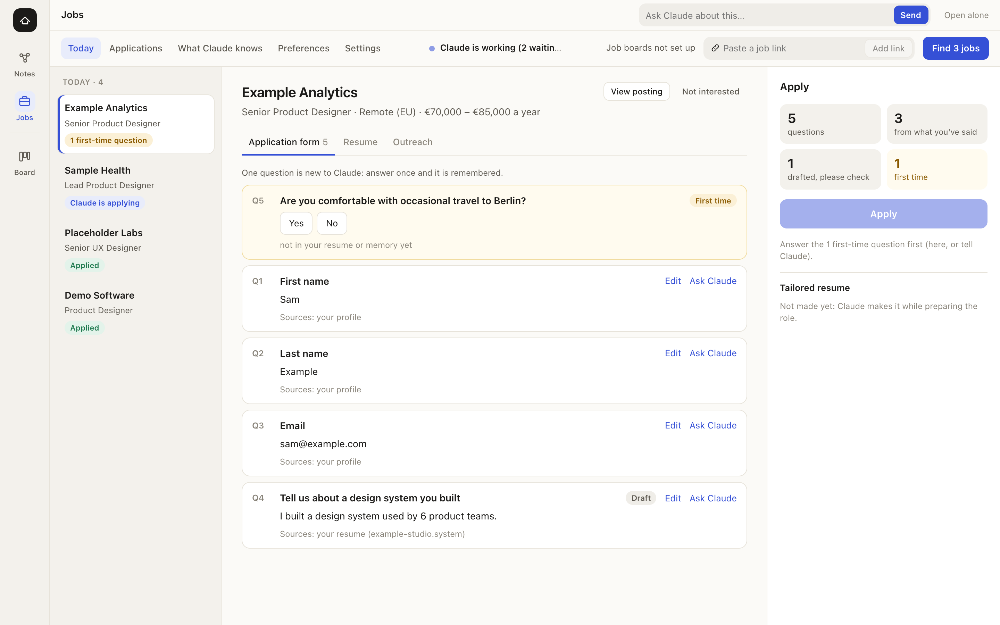
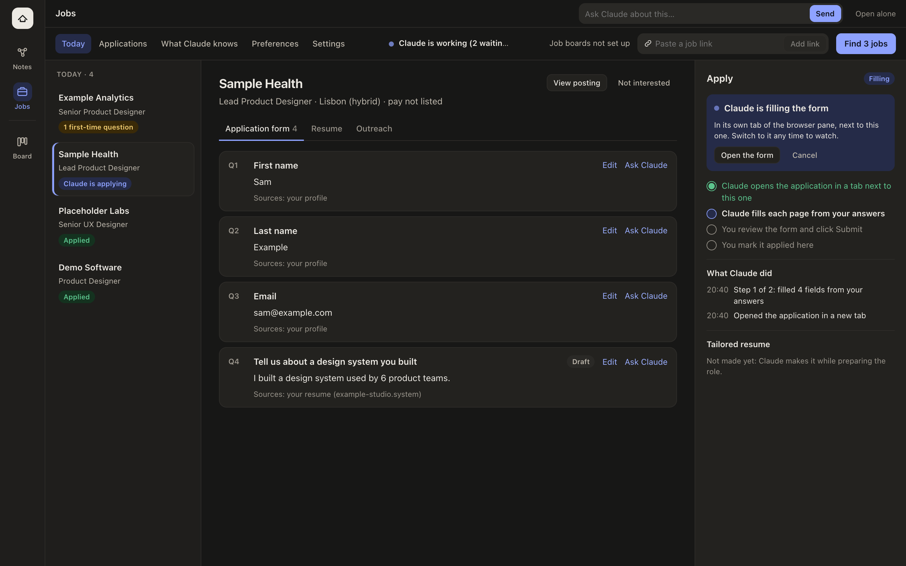

# PR: Jobs — a job search for anyone, in Crewdeck

Branch `feat/jobs-module` → `main`. Not opened and not pushed: the owner decides after the acceptance run.

## Summary

Crewdeck gains **Jobs**, a first-party module for a job search in any role and any country, next to Notes and Boards in
the same rail and theme. Claude interviews the user once and writes their notes; it finds roles within a token budget,
reads a posting the user pastes, prepares every answer from the user's own facts and words, and fills the real
application form in a tab of Claude desktop's browser pane. **The user clicks Submit; Crewdeck never submits.** Everything
Claude knows about the user is a note in their vault they can read and edit; machine state stays in `~/.crewdeck/jobs`.
The repo contains no personal data, and a leak scan enforces it.

On the way, the existing shell got a security baseline and a full security review: SilverBullet moved to a private Unix
socket, the bridge proves the server before sending its token (which now rotates), the jobs workspace runs Claude's
shell in Claude Code's sandbox, and risky switches need the user's own click in a native dialog.

## Contents

- **Notes and rules** (`src/jobs/notes.ts`, `schema.ts`, `rules.ts`, `places.ts`, `pay.ts`): schema v1 for
  `me/profile.md`, `me/career.md`, `jobs/search.md` (+ a dated Changes log), `jobs/memory.md`, `jobs/sources.md`;
  comment-preserving atomic writes, last-valid fallback; typed settings compiled to near-certain drops (gazetteer
  containment, pay in any currency and period); everything subtle goes to the judge with the user's words.
- **Core** (`src/jobs/db.ts`, `kb/`, `draft/`, `pipeline/`, `plan.ts`, `resume/`): SQLite tracker with migrations,
  knowledge base, drafting brief + citation check (numbers by value, own-sources-only sentences), fill plan (never a
  submit/review action), resume PDF from fact ids.
- **The web side** (`src/jobs/net/`, `link.ts`, `read-form.ts`, `browser.ts`, `linkedin.ts`): netguard (SSRF), a guard
  proxy for headless Chromium, posting and form reading, gated LinkedIn guest pages.
- **Server, UI, bridge** (`src/jobs/api.ts`, `web/jobs/`, `src/requests.ts`, `plugin/hooks/register.tsx`): typed requests
  on one queue (dedupe, caps per lane and kind, progress, presence, leases, Cancel), the Jobs page (Today, apply panel,
  Applications, What Claude knows, Preferences, Settings, setup card), SSE live updates.
- **Setup and skills** (`src/jobs/setup.ts`, `presets/jobs/`, `vault-template/`, `plugin/skills/`): `crewdeck jobs
  init`, four presets, the managed jobs workspace (`CLAUDE.md` + sandbox settings), the skills `jobs-workspace`,
  `jobs-setup`, `jobs-daily-run`, `crewdeck-memory`; the plugin renamed `crewdeck`.
- **Sources** (`src/jobs/providers.ts`, `provider-runner.ts`, `sources.ts`, `schedule.ts`): pinned career-ops providers
  (hash-checked import closure), a no-network permission-model child (Node 25+), scheduled fetching, code ranking,
  budgeted Find.
- **Tests**: ported unit tests, journey tests for two fictional people (`test/jobs/e2e/`), security regression tests, a
  browser layout test.
- **Docs**: README for a new user, [docs/jobs/first-run.md](../first-run.md), [docs/design.md](../../design.md),
  [CHANGELOG.md](../../../CHANGELOG.md), [docs/roadmap.md](../../roadmap.md), the Jobs design and one implementer doc per
  phase (`docs/jobs/impl/`).

## Breaking changes

- The plugin is **`crewdeck` 0.4.0** (renamed from `crewdeck-bridge` in 0.3.0; 0.4.0 for the handshake). Users
  uninstall the old plugin, remove and re-add the `crewdeck` marketplace, and install `crewdeck@crewdeck`.
- **Challenge-first token handshake**, token rotated on every `crewdeck up`; request-scoped agent calls must come from
  the request's lane. The old bridge can't talk to the new server.
- **SilverBullet on a Unix socket** (no TCP port, shell backend off); board internal ports are random per start.
- **Job-board sourcing needs Node ≥ 25**; everything else stays on Node ≥ 22.18.
- Page endpoints require `Sec-Fetch-Site: same-origin` from browsers; `/api/requests` no longer takes `jobs` requests;
  no `--force` on `crewdeck jobs pick|link`.

## Tests

A fresh clone of the branch (`git clone` of the local repo into a scratch folder, `npm ci && npm test`, which runs the
leak scan first), on 2026-11-19 at `810a5db`:

| Node | Tests | Pass | Skip | Fail |
|---|---|---|---|---|
| 25.9.0 | 434 | 432 | 2 | 0 |
| 22.18.0 | 434 | 425 | 9 | 0 |

Skips: on both, the manifest rebuild check (needs `CAREER_OPS_CHECKOUT`). On 25, the "refuses on Node < 25" check. On
22.18, the eight provider-sandbox tests, each with the reason (they need Node 25). `npm audit --omit=dev`: 0
vulnerabilities. CI runs Node 22, 24 and 25.

## Security review

[07-security-review.md](07-security-review.md): a `/security-review` and a multi-lens review of the whole diff: 26
findings (W6–W10 grouped; 1 critical, 7 high), all fixed in two passes with regression tests. The critical one was pre-existing on
`main`: SilverBullet's internal port took cross-site `POST /.shell`; it now has no TCP port and its shell is off. Other
highlights: the bridge never sends its token to an unproven server; the jobs workspace's Bash runs in Claude Code's
sandbox with no network; risky switches need a native dialog; providers run with no network and frozen built-ins; file
flags only inside Jobs' folders; no `--force`; a value-based citation check; the leak scan reads history, commit
bodies, UTF-16 and every pushed blob.

## Residual risks

- Any process running as the user outside the sandbox can forge page headers and reach the board ports.
- Backlog.md 1.55.3 has no socket, auth or Host/Origin check: a page spraying local ports could create a board task
  (random port per start; an upstream issue is drafted, not filed).
- In the browser pane, "never submit" and "open only the role's pages" are prompt-level rules.
- Claude Code's sandbox prompts (rather than refuses) for unknown hosts unless the user sets `strictAllowlist` in their
  own settings; sessions outside the jobs workspace have no sandbox from Crewdeck; Linux needs bubblewrap and socat.
- Providers can still make public requests through Crewdeck (capped) and return misleading postings (validated); their
  sandbox is Node's permission model.
- The citation check reads numbers and named terms, not meaning.

## Screenshots

Fictional data only (Sam Example, `example.com` companies), from a temp home on ports outside the owner's.

| | |
|---|---|
|  |  |
|  |  |
|  |  |
|  |  |

## How to try it

Follow [docs/jobs/first-run.md](../first-run.md). In short, from a checkout of the branch:

```bash
npm ci
node src/cli.ts init && node src/cli.ts jobs init && node src/cli.ts up     # Node 25 for job-board sourcing
claude plugin marketplace add "$PWD"
claude plugin install crewdeck@crewdeck --config port=4848
```

Open http://localhost:4848 in Claude desktop's browser pane, open a Claude Code session in `~/.crewdeck/jobs`, click
**Set up with Claude**, then paste a job link. To try it without touching an existing setup, move `~/.crewdeck` and the
vault aside first (first-run guide, step 0), or set `CREWDECK_HOME` to a temp folder and pass `--vault` (the bridge then
needs `CREWDECK_HOME` in Claude's environment too).

🤖 Generated with [Claude Code](https://claude.com/claude-code)
